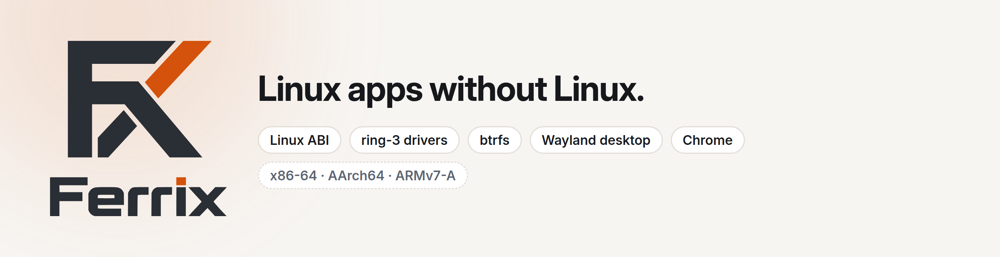
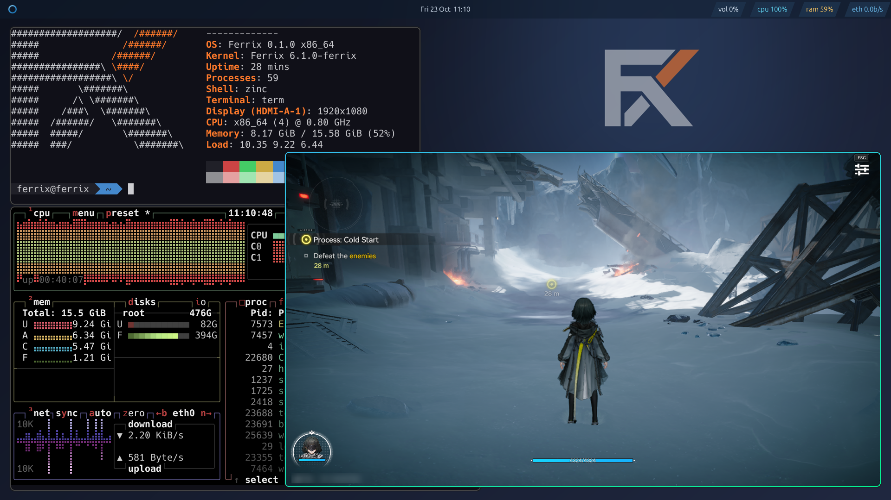
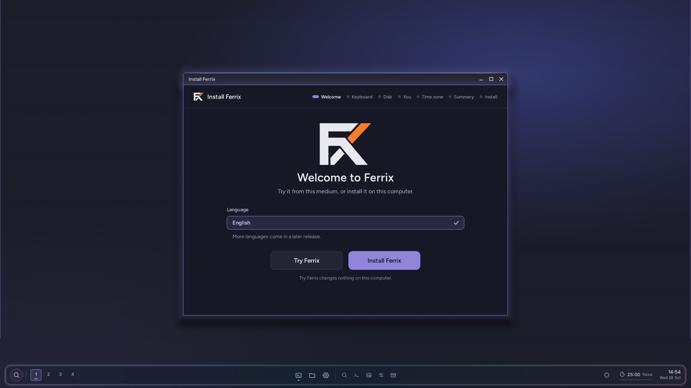
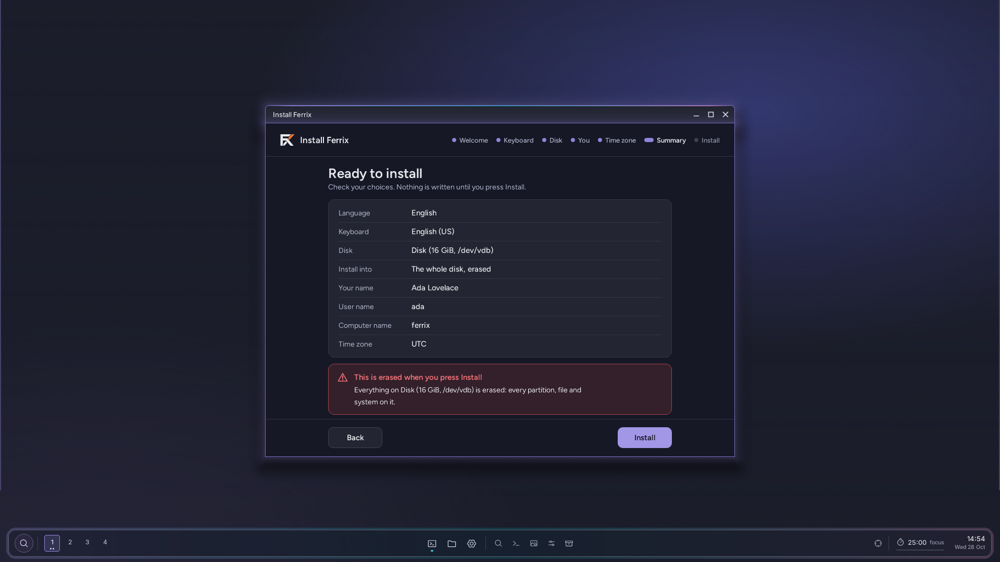
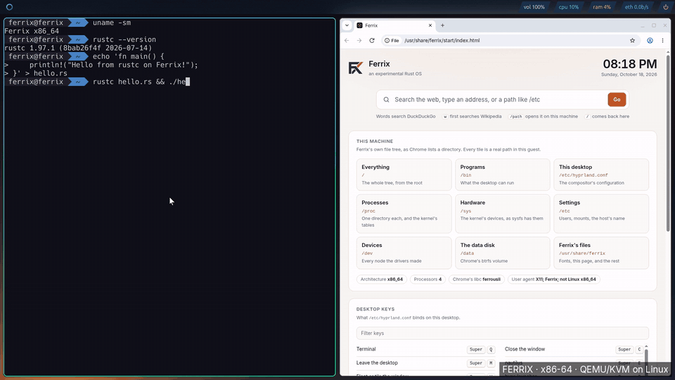
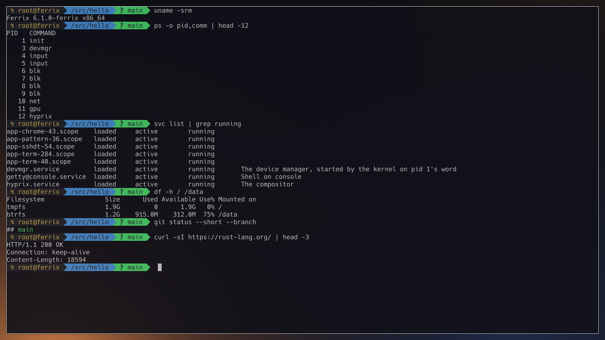
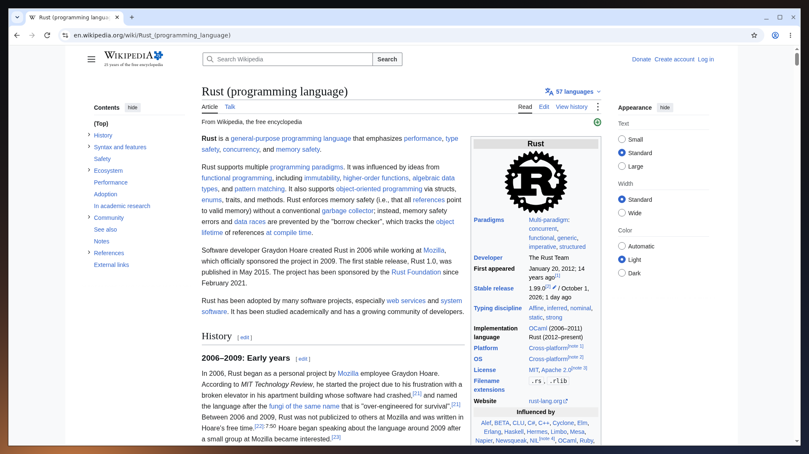
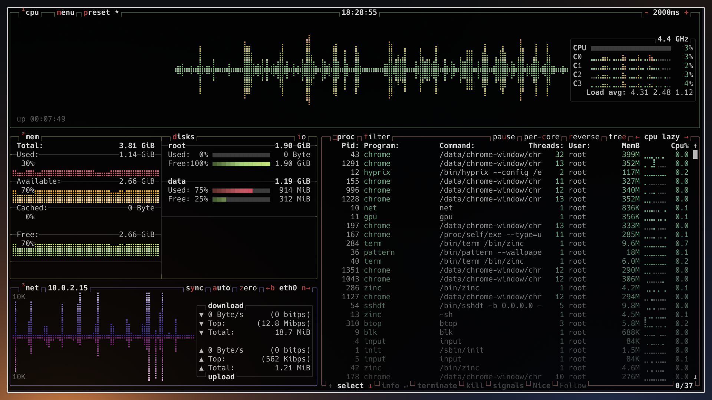
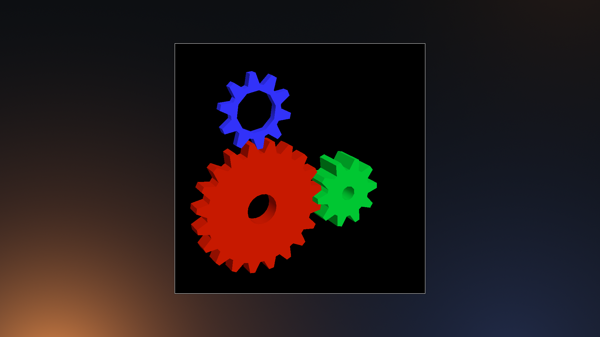
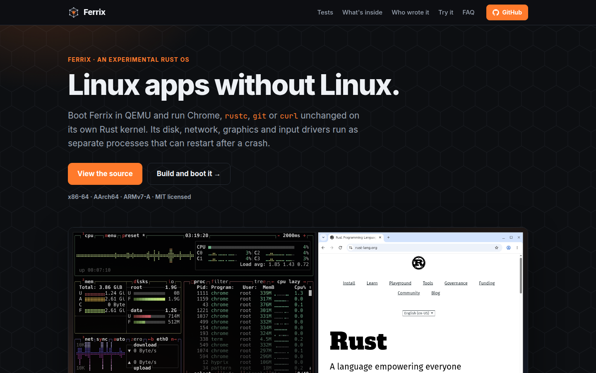

<p align="center">
  <picture>
    <source media="(prefers-color-scheme: dark)" srcset="docs/brand/banner-dark.png">
    
  </picture>
</p>

# Ferrix

**An operating system written by a fleet of Claude Code sessions.**

Claude Code sessions write Ferrix: its Rust kernel,
its drivers, its compositor, its shell and its tests. A person, the
customer, decides what is built, in what order, and what is good enough.
The sessions plan the work, write the code, review each other's changes and
land them once their tests pass. [How the fleet works](#how-the-fleet-works)
says who does what.

**Linux apps without Linux.** Ferrix runs tested, unchanged Linux programs
on its own kernel: Chrome, `git`, `curl`, `rustc`, Valve's Steam client and,
through Proton, a Windows game. Disk, network, graphics, input and power
drivers run as separate processes that Ferrix can restart when they crash.

Ferrix is experimental. Logins, `su` and the lock screen check passwords,
but it is not ready to be your everyday operating system, and most of its
tests run in QEMU.

[See what works](#what-works) · [Try it without building](#try-it-without-building) ·
[Boot Ferrix](#boot-ferrix) · [Read the technical guide](docs/GUIDE.md) ·
[Visit the website](https://ferrix-os.org/)



*Ferrix's desktop, Yoru, on an Intel N150 mini PC: Arknights: Endfield from
Steam, in a window, through Ferrix's own Intel GPU driver, with btop and
ferrofetch beside it.*

## A Windows game on a mini PC

Arknights: Endfield runs on an Intel N150 mini PC under Ferrix, started from
Steam through Proton and drawn by Mesa's Vulkan driver over Ferrix's own
Intel GPU driver ([docs/INTEL-GPU.md](docs/INTEL-GPU.md)). That driver is not
in the kernel: it is an ordinary process, written by following Linux's i915
file by file. The game is playable, but not smooth yet.

On the same machine the GPU driver can be killed with `kill -9` while the
system runs. Ferrix starts it again within milliseconds, and Vulkan finds
the GPU again afterwards
([docs/INTEL-GPU.md](docs/INTEL-GPU.md) §11). Under QEMU the driver can also
run as two processes, a keeper that holds what programs hold and a worker
that drives the GPU, so that a worker can die and be replaced while a
Vulkan program goes on (§12, step 1 of its plan).

## What works

- **Linux programs, unchanged:** Chrome, `rustc`, `git`, `curl`, Valve's
  `steamcmd` and Steam client, and other tested binaries, 32-bit x86 programs
  included. Wine and Proton run Windows programs, among them Endfield's
  launcher and the game. Claude Code runs a full session on Ferrix's desktop
  ([docs/CLAUDE-CODE.md](docs/CLAUDE-CODE.md)). Ferrix implements the Linux
  system calls these programs need, and has its own C library, ferrousli.
- **A desktop:** hyprix, Ferrix's Wayland compositor, reads `hyprland.conf`
  and tiles windows. It also has a floating layout with snapping, an
  activities overview, title bars it draws itself, and screens added and
  removed while it runs. Yoru, Ferrix's default desktop, adds a dock and
  sidebars on top of it
  ([docs/DESKTOP.md](docs/DESKTOP.md)). A fullscreen program's own buffer can
  go straight to the screen. Each display driver lists the modes its screen
  can run, on Intel, NVIDIA and virtio GPUs, and the mode can change at run
  time ([docs/DISPLAY.md](docs/DISPLAY.md)). GTK 4 and libadwaita programs
  from Debian 13 run on it ([docs/GNOME.md](docs/GNOME.md)). X11 programs
  appear as ordinary windows through yserver, an X server written in Rust.
- **Drivers outside the kernel:** disk, network, graphics, input, sound,
  console and power drivers run as processes. On x86-64 and AArch64 an IOMMU
  limits what a driver's device can reach. A driver's processes are sealed
  in a job: none can leave it except by ending, so killing the job ends them
  all. On the N150, a ring-3 power driver sets the processor's
  voltage-regulator current limit through typed kernel calls
  ([docs/POWERCTL.md](docs/POWERCTL.md)).
- **Real hardware:** on the N150, Ferrix boots to its desktop with `/` on the
  SATA drive, its own network driver for the Motorcomm YT6801, USB input and
  the Intel GPU ([docs/N150.md](docs/N150.md)). It has also booted on a
  Pixel 7, on all eight cores, and on an STM32MP157D-DK1 board. NVIDIA's own
  driver runs as a process on an RTX 3060 passed to a virtual machine. Every
  landing that changes the image boots it on x86-64, AArch64 and ARMv7-A.
- **Users, namespaces and containers:** the full desktop runs as the user
  `ferrix`, not root, and passwords are checked by `authd`. Ferrix has pid,
  user, mount, network, UTS, IPC and cgroup namespaces, cgroup v2 limits and
  seccomp filters; `cargo xtask test-container` runs an unprivileged
  container under a memory limit on all three architectures.
- **Storage, networking, updates:** the root filesystem is btrfs, read and
  write. Inside Ferrix, `git` clones a repository and `curl` fetches over
  HTTPS. A disk can carry two system slots, and a new system that does not
  come up falls back to the good one ([docs/AB-BOOT.md](docs/AB-BOOT.md)).
- **Developing Ferrix on Ferrix:** the toolchain volume carries `cargo`,
  `clippy`, `rust-analyzer` and the helix editor, and Ferrix builds its own
  image ([docs/DEV-ON-FERRIX.md](docs/DEV-ON-FERRIX.md)). The zinc shell is
  zsh-compatible, runs oh-my-zsh, and behaves as zsh's `sh` emulation when it
  is started as `sh`.
- **A kernel without the Linux layer, as a build:** the build flag
  `linux_abi=off` builds a kernel that speaks only Ferrix's own system calls.
  Its code is 1.4 MB against 7.4 MB with the Linux layer, on x86-64
  ([docs/LINUX-ABI-SEPARATION.md](docs/LINUX-ABI-SEPARATION.md)). It is built,
  not booted or claimed for anything yet.

[The roadmap](docs/roadmap/where-it-stands.md) tracks what is done and what is
still being built, and [the backlog](docs/BACKLOG.md) what is broken.

## How the fleet works

Ferrix is not one long chat. It is a team of Claude Code sessions with
roles, and one person, the customer, above them ([AGENTS.md](AGENTS.md)).

- **The customer** decides scope, priorities and every question of
  judgement: which game to aim at, how slim the kernel stays, whether a
  power limit may be raised on real hardware.
- **The product owner**, a Claude session, turns the customer's requests
  into tasks, starts agents for them, and lands their work.
- **Worker agents** each work in a git worktree of their own, build and boot
  their change in QEMU, and send it to a shared **gate pool** that runs the
  tests a change needs.
- **A landing lock** lets one session at a time move `main`, fast-forward
  only, once its tests passed.
- **The certification consultant**, another Claude session, reviews every
  change to the kernel's certified core before it lands, and asks for a
  negative control: the check is broken on purpose and must fail.
- **Quality roles** watch CI, flaky tests, documentation drift and
  performance.

The [working rules](docs/CONVENTIONS.md) come from mistakes the fleet made,
and each says which one. Human contributions are welcome; see
[CONTRIBUTING.md](CONTRIBUTING.md).

**Certification is an aim, not a fact.** The project aims at Common
Criteria EAL5+, DO-178C DAL C, IEC 62304 Class C and EN 50716 SIL 2 for the
kernel's core. Nothing is certified, and no outside assessor is involved:
the consultant's review is internal, not independent. Its findings register,
open and closed findings alike, is in
[docs/certification/](docs/certification/README.md).

<table>
  <tr>
    <td width="50%"></td>
    <td width="50%"></td>
  </tr>
  <tr>
    <td>The live ISO: Yoru and the installer.</td>
    <td>The installer's last page, before anything is written.</td>
  </tr>
</table>

[](docs/brand/screenshots/demo.mp4)

*15 seconds, in real time, of [a 70-second recording](docs/brand/screenshots/demo.mp4)
that starts at the firmware: `rustc` compiling and running a program, then Chrome
loading Wikipedia.*

<table>
  <tr>
    <td width="33%"></td>
    <td width="33%"></td>
    <td width="33%"></td>
  </tr>
  <tr>
    <td>The zinc shell, driver processes and a <code>curl</code> request.</td>
    <td>Chrome browsing Wikipedia on Ferrix.</td>
    <td><code>btop</code> showing what's running.</td>
  </tr>
</table>

*Captured on x86-64 under KVM. [How the screenshots were made](docs/brand/screenshots/CAPTIONS.md).*

## The repositories

Ferrix lives in the [ferrix-os](https://github.com/ferrix-os) organization. This
repository holds the kernel, its libraries, the system's programs and the build;
the parts below have repositories of their own, which `cargo xtask` checks out into
this tree at the commits [`components.toml`](components.toml) names.

<table>
  <tr>
    <td width="50%" valign="top">
      <a href="https://github.com/ferrix-os/ferrousli"></a>
      <br><b><a href="https://github.com/ferrix-os/ferrousli">ferrix-os/ferrousli</a></b><br>
      The C library, written in Rust, that Linux programs on Ferrix are built against,
      and the toolkit they are ported onto it with.
    </td>
    <td width="50%" valign="top">
      <a href="https://github.com/ferrix-os/zinc"></a>
      <br><b><a href="https://github.com/ferrix-os/zinc">ferrix-os/zinc</a></b><br>
      The zsh-compatible shell, written in Rust, with oh-my-zsh running in it.
    </td>
  </tr>
  <tr>
    <td width="50%" valign="top">
      <a href="https://github.com/ferrix-os/apps"></a>
      <br><b><a href="https://github.com/ferrix-os/apps">ferrix-os/apps</a></b><br>
      Every program a person starts: Ferrix's own, like badapple and ferrofetch,
      and those ported onto ferrousli, like foot, btop, curl, git and vkgears.
    </td>
    <td width="50%" valign="top">
      <a href="https://github.com/ferrix-os/ferrix-os.github.io"></a>
      <br><b><a href="https://github.com/ferrix-os/ferrix-os.github.io">ferrix-os/ferrix-os.github.io</a></b><br>
      The website, at <a href="https://ferrix-os.org/">ferrix-os.org</a>.
    </td>
  </tr>
  <tr>
    <td width="50%" valign="top">
      <b><a href="https://github.com/ferrix-os/yserver">ferrix-os/yserver</a></b><br>
      The X server, in Rust, that Steam, Proton's games and other X11 programs
      draw through, on Ferrix's rootless Wayland backend.
    </td>
    <td width="50%" valign="top">
      <a href="https://github.com/ferrix-os/pixel7"></a>
      <br><b><a href="https://github.com/ferrix-os/pixel7">ferrix-os/pixel7</a></b><br>
      Ferrix on the Pixel 7: the Android launcher app, the desktop build, release
      packaging and the monitor.
    </td>
  </tr>
</table>

## Try it without building

From v0.2.0 on, each release also carries a live ISO: Yoru's desktop
from a CD, a virtual disk or a USB stick, with an installer that puts
Ferrix on a disk of its own. [Try Ferrix](docs/TRY-FERRIX.md) covers QEMU,
VirtualBox, VMware and writing the stick.

Each release carries the x86-64 desktop as one zip. You need QEMU and
nothing else: no Rust, no build. On Linux or macOS:

```sh
curl -LO https://github.com/ferrix-os/ferrix/releases/latest/download/ferrix-x86_64-desktop.zip
unzip ferrix-x86_64-desktop.zip && sh ferrix-x86_64-desktop/run.sh
```

On Windows, in PowerShell:

```powershell
Invoke-WebRequest https://github.com/ferrix-os/ferrix/releases/latest/download/ferrix-x86_64-desktop.zip -OutFile ferrix.zip
Expand-Archive ferrix.zip .; powershell -ExecutionPolicy Bypass -File ferrix-x86_64-desktop\run.ps1
```

A QEMU window opens on the desktop with a terminal in it; try `btop`,
`ferrofetch` or `curl https://example.com`. The scripts use KVM, WHPX or
HVF when the machine has one and emulate otherwise, which is slower. The
desktop is the one `cargo xtask run-compositor` boots, minus what needs a
download of its own: no Chrome, no Steam and no `rustc`. `/` lives in
memory, so nothing is kept after QEMU exits. With released QEMU on Windows
the guest gets one processor. The zip's `README.txt` covers firmware,
options and the rest. The [install guide](docs/INSTALL.md) walks through
it with pictures of each step on Windows and Linux, says what to do when
a step fails, and where installing Ferrix on a disk stands.

## Boot Ferrix

Install Rust and QEMU, then:

```sh
git clone https://github.com/ferrix-os/ferrix.git
cd ferrix
cargo xtask run --arch x86_64
```

That opens a serial console. For the desktop, run `cargo xtask run-compositor`.
The [technical guide](docs/GUIDE.md#getting-started) covers firmware requirements,
other architectures, Windows, graphics options and the extra downloads needed
for Chrome and the Rust toolchain. Quit QEMU with `Ctrl-A`, then `x`.

## Check the claims

The boot test starts Ferrix on all three architectures:

```sh
cargo xtask test-boot --arch all
```

Other tests compile a program with an unmodified `rustc` inside Ferrix and boot
an x86-64 image built inside Ferrix. Ferrix has also built its own AArch64
image inside Ferrix on a Pixel 7, in the phone's own virtual machine, and
that image passed the boot test. The [guide](docs/GUIDE.md#proof-you-can-run)
has the commands and serial output. These tests demonstrate specific working
paths; they are not a claim that every Linux app works. What this page says
about the N150 comes from runs on that one machine, not from a gate.

Ferrix is MIT licensed. [Explore the code and component docs](docs/GUIDE.md#layout),
[get the logo and press kit](docs/marketing/README.md), or
[open an issue](https://github.com/ferrix-os/ferrix/issues).
