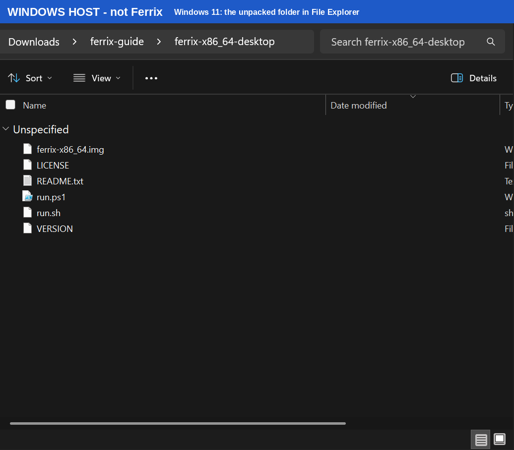
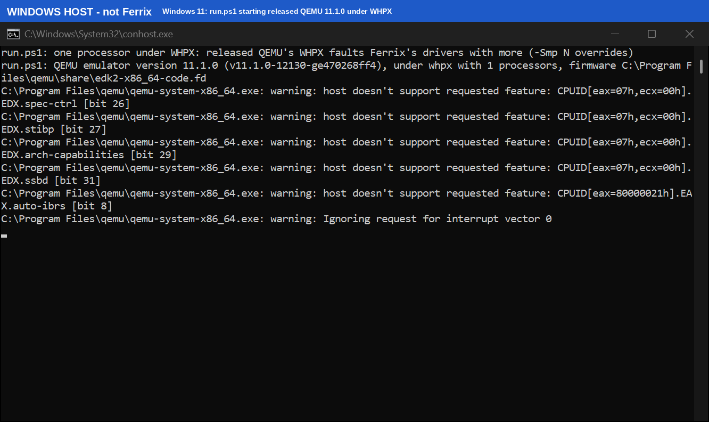
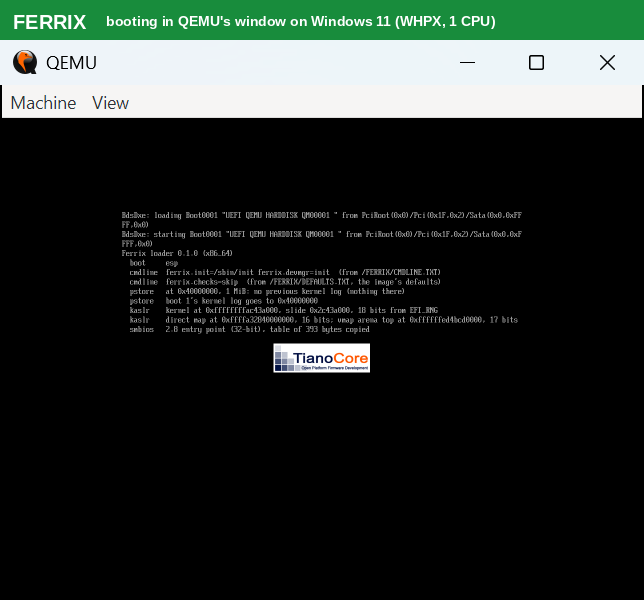
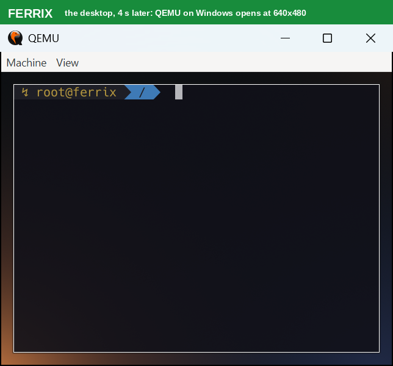
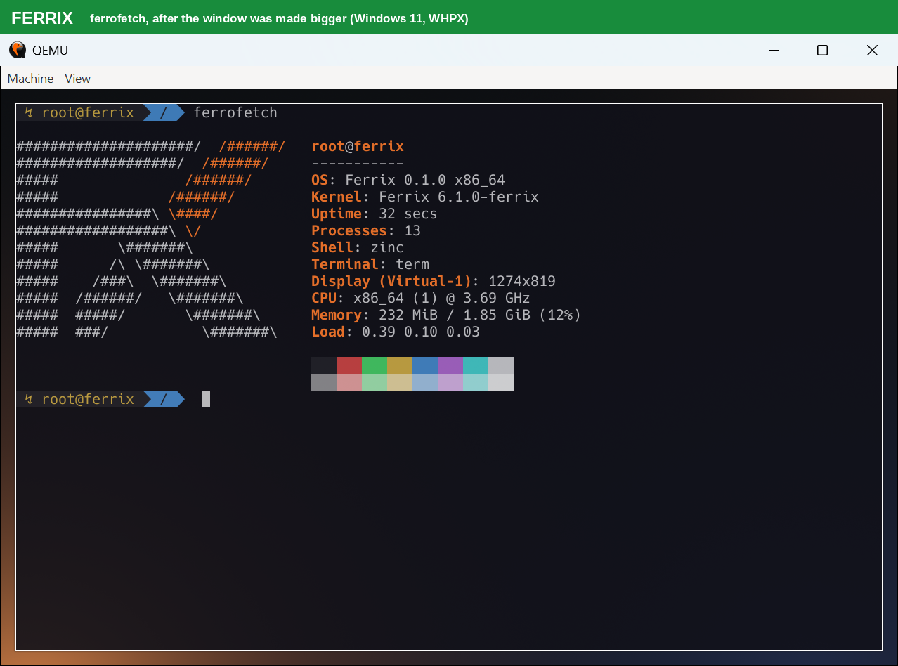
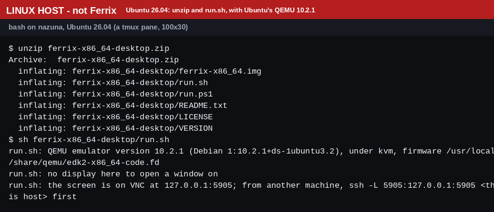
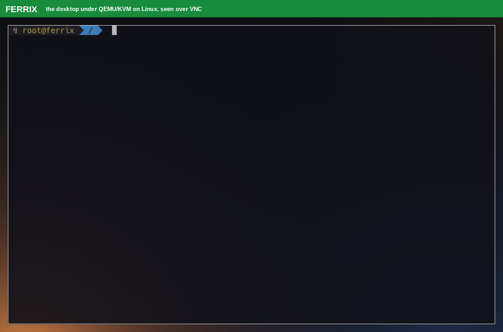
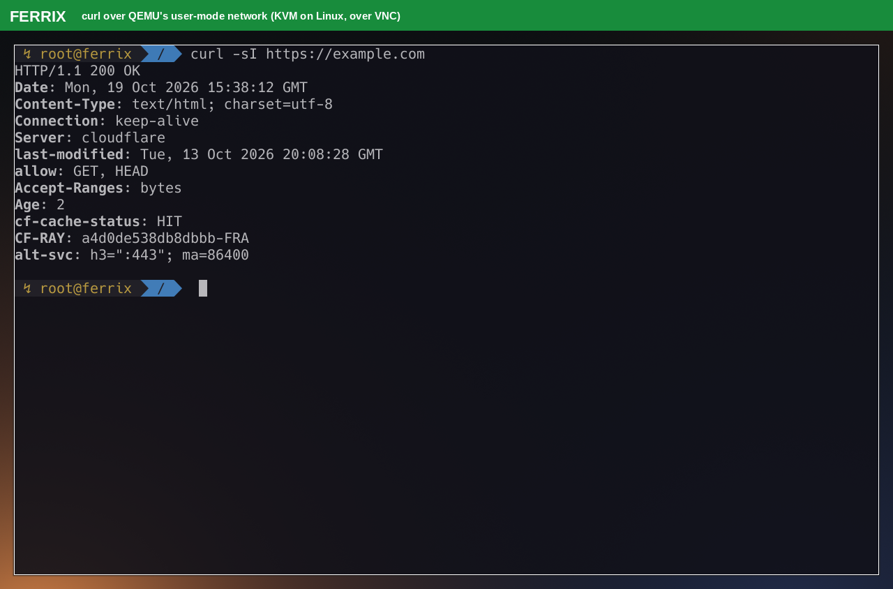
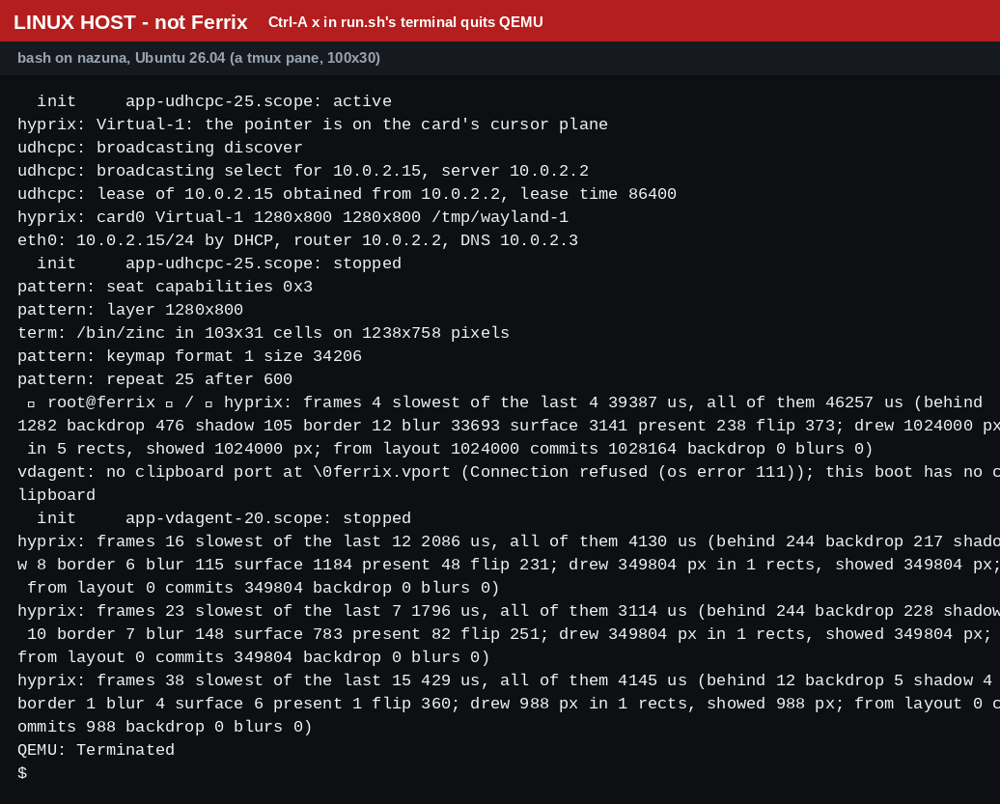

# Installing Ferrix

Ferrix is an experimental operating system with its own Rust kernel that
runs ordinary Linux programs. This guide gets it running on your machine.
You need no Rust and no build for the first part, only QEMU, a free
virtual machine program. Every picture below is a capture of what the
steps print and show, taken on 2026-10-19; the coloured band on top of
each says which system it is (green **FERRIX**, red **LINUX HOST**, blue
**WINDOWS HOST**). [CAPTIONS.md](brand/screenshots/CAPTIONS.md#the-install-guide-2026-10-19)
says how each one was made.

There are two ways in, and only the first is ready:

1. **[Try Ferrix in QEMU](#1-try-ferrix-in-qemu)** from one download: the
   desktop in a window, a few seconds after you start it. Nothing is
   written to your disks, and nothing you do inside is kept.
2. **[Installing to a disk](#2-installing-to-a-disk)**: not ready for
   anybody's PC yet. That section says what exists and what does not.

Ferrix is not ready to be anybody's everyday system: parts of
authentication and process isolation are unfinished. Don't put anything
you care about in it.

## 1. Try Ferrix in QEMU

### What you need

- A 64-bit x86 PC (Intel or AMD) running Windows 11 or Linux (Windows 10
  should work the same; nobody has tried it). A Mac may work too
  (see [macOS](#macos-untested)).
- About 600 MB of free disk: a 52 MB download that unpacks to 512 MB.
- 2 GB of memory to give the virtual machine.
- QEMU. The steps below install it.

### Step 1: download the zip

Each release of Ferrix carries the desktop as one file,
`ferrix-x86_64-desktop.zip`, on the
[releases page](https://github.com/ferrix-os/ferrix/releases).

**Not published yet.** As of 2026-10-19 there is no release yet, and the
download link below answers "404 Not Found" until the first one is
published. The zip in these pictures was built from the source with
`tools/common/release/package-desktop.py`, the same script the release
workflow runs. If you want to try Ferrix before the release, you can
[build it yourself](#building-the-zip-yourself).

Inside the zip is one folder, `ferrix-x86_64-desktop`, which holds:

| File | What it is |
|---|---|
| `ferrix-x86_64.img` | The disk QEMU boots: Ferrix's UEFI loader, its kernel and every program |
| `run.ps1` | Starts it on Windows |
| `run.sh` | Starts it on Linux and macOS |
| `README.txt` | Its options, and what the zip leaves out |
| `LICENSE`, `VERSION` | Ferrix's licence, and the commit the image was built from |

### On Windows

**1. Install QEMU.** Use the installer from
[qemu.weilnetz.de](https://qemu.weilnetz.de/w64/), the build qemu.org
links to, or install it in a PowerShell window with winget:

```powershell
winget install SoftwareFreedomConservancy.QEMU
```

Either way, QEMU ends up in `C:\Program Files\qemu`, where `run.ps1` looks
for it. The pictures were taken with QEMU 11.1.0, the version winget
offered on 2026-10-19 (`winget show SoftwareFreedomConservancy.QEMU`).

For speed, Windows' own hypervisor should run the virtual machine. Open
*Turn Windows features on or off*, tick **Windows Hypervisor Platform**,
and restart. Without it QEMU emulates the processor, which works but is
much slower.

**2. Unpack the zip.** Right-click it in File Explorer, choose
*Extract All...*, and extract it where it is. Or, in PowerShell, in the
folder the zip is in:

```powershell
Expand-Archive ferrix-x86_64-desktop.zip .
```



**3. Start it.** In PowerShell, in the same folder:

```powershell
powershell -ExecutionPolicy Bypass -File ferrix-x86_64-desktop\run.ps1
```

`-ExecutionPolicy Bypass` lets this one script run, without changing
your settings for any other. The console tells you what it found: the
QEMU version, whether Windows' hypervisor (WHPX) is in use, and how many
processors the guest gets. QEMU then prints a handful of warnings about
processor features the host does not offer (`spec-ctrl`, `stibp`,
`arch-capabilities`, `ssbd`, `auto-ibrs`) and one about interrupt vector
0. None of these stops Ferrix.



**One processor.** Under WHPX, released QEMU faults Ferrix's drivers when
the guest has more than one processor, so `run.ps1` gives it one (the
first line in the picture says so). The desktop runs fine on one;
heavier programs are slower. A patched QEMU that fixes this is built by
`tools/common/fetch/fetch-qemu-windows.sh`, which is for developers.

A QEMU window opens. First the firmware starts Ferrix's loader, which
prints what it loads:



**4. The desktop.** On the PC in the pictures it was up 4 seconds after the
window opened, on its one processor:
hyprix, Ferrix's Wayland compositor, with one terminal running zinc,
Ferrix's zsh-compatible shell.



The window opens small, at 640x480. Drag its corner to make it bigger, or
maximize it: Ferrix's screen follows the window's size within a few
seconds. This is a known shortcoming (the
[backlog](backlog/p2.md) has it), not a fault in your setup.

**5. Try a command.** Click into the terminal and type `ferrofetch`, then
Enter:



Then [see what to try next](#things-to-try). To stop, close QEMU's window.
Nothing you did inside is kept.

### On Linux

**1. Install QEMU and its UEFI firmware.**

| Distribution | Command |
|---|---|
| Debian, Ubuntu | `sudo apt install qemu-system-x86 ovmf` |
| Fedora | `sudo dnf install qemu-system-x86 edk2-ovmf` |
| Arch | `sudo pacman -S qemu-full edk2-ovmf` |

For speed, QEMU should use KVM, the kernel's hypervisor. That needs
`/dev/kvm` to be yours: if `run.sh` says "/dev/kvm is there but not yours
to open", run `sudo usermod -aG kvm $USER` and log in again. Without KVM,
QEMU emulates the processor, and Ferrix works, much more slowly.

**2. Download and unpack it, then start it:**

```sh
curl -LO https://github.com/ferrix-os/ferrix/releases/latest/download/ferrix-x86_64-desktop.zip
unzip ferrix-x86_64-desktop.zip
sh ferrix-x86_64-desktop/run.sh
```

(The `curl` line waits for the first release, as [Step 1](#step-1-download-the-zip)
says.) `run.sh` says which QEMU it found, whether KVM is in use, and which
firmware it loads:



On a desktop session, QEMU opens a window, as on Windows. The machine in
the picture is a server with no display, so `run.sh` put the screen on
VNC instead, and says where. Any VNC viewer shows it there; from another
machine, forward the port with `ssh -L 5905:127.0.0.1:5905 <the server>`
first. `sh ferrix-x86_64-desktop/run.sh --vnc 5` does the same on purpose.

After the firmware's messages, the terminal you started it from shows
Ferrix's serial console: the kernel's log, then a shell of its own. Under
KVM the desktop was up 4 seconds after QEMU started:



Ferrix has a network through QEMU, so this works from the start:

```sh
curl -sI https://example.com
```



**3. Stop it.** Close the window, or press **Ctrl-A** and then **x** in the
terminal you started `run.sh` from. QEMU prints `QEMU: Terminated`:



### macOS (untested)

`run.sh` runs on macOS too, with QEMU from Homebrew (`brew install qemu`):
`sh ferrix-x86_64-desktop/run.sh`. On an Intel Mac it uses Apple's
hypervisor (HVF). On an Apple Silicon Mac, QEMU has to emulate an x86
processor, which works but is slow. **Nobody has run it on a Mac yet**,
so it may fail in ways this guide doesn't know about. If you try it,
please [open an issue](https://github.com/ferrix-os/ferrix/issues) and
say what happened.

### Things to try

Keys: **Super+Enter** opens another terminal, **Super+Q** closes a window,
**Super+F** makes one fullscreen, **Super+1** and **Super+2** switch
workspaces. Super is the Windows key. The keyboard layout is US.

In the terminal:

| Command | What it shows |
|---|---|
| `ferrofetch` | The system at a glance |
| `btop` | Processes, processors, memory and network, live (q quits) |
| `curl -sI https://example.com` | The network, through QEMU |
| `svc status` | The services init started |
| `git --version` | `git` 2.55.0, a Linux program built for Ferrix's own libc |

The zip leaves out what needs gigabytes of its own: Chrome, Steam and the
Rust toolchain. `/` is in memory, so nothing survives QEMU exiting. The
screen is drawn in software, which is fine for terminals and slow for
anything big.

### When something goes wrong

| What you see | What to do |
|---|---|
| `qemu-system-x86_64.exe not found` (Windows) | QEMU isn't installed where `run.ps1` looks. Install it as above, or pass `-Qemu <path to qemu-system-x86_64.exe>` |
| `qemu-system-x86_64 is not on PATH` (Linux) | Install your distribution's QEMU package (the table above) |
| `no UEFI firmware (OVMF) found` | Install `ovmf` (Debian, Ubuntu) or `edk2-ovmf` (Fedora, Arch), or name the files with `OVMF_CODE=... OVMF_VARS=... sh run.sh` |
| `network backend 'user' is not compiled into this binary` | Your QEMU was built without its user-mode network. Use your distribution's QEMU; `QEMU_SYSTEM=/usr/bin/qemu-system-x86_64 sh run.sh` picks it when another one comes first on `PATH`. This happened while these pictures were taken, with a QEMU built from source in `/usr/local` |
| `WHPX did not start ... emulating` (Windows) | Turn on *Windows Hypervisor Platform* (above) and restart. Until then it works, slowly |
| `/dev/kvm is there but not yours to open` (Linux) | Join the `kvm` group (above), then log in again |
| The window is small | Make it bigger; the desktop follows |

`sh run.sh --help` lists the options (`--vnc`, `--memory`, `--smp`,
`--size`, `--tcg`), and `run.ps1`'s first lines list its own. If you hit
anything else, please [open an issue](https://github.com/ferrix-os/ferrix/issues)
with the console's output.

### Building the zip yourself

Until the first release is published, or to try the newest source, build
the zip on Linux. It takes Rust and the tools the
[technical guide](GUIDE.md#getting-started) lists, and it builds every
program in the image, so the first build is long (7 minutes on the build
machine these pictures came from, whose caches were warm; expect much
more on a fresh one):

```sh
git clone https://github.com/ferrix-os/ferrix.git
cd ferrix
python3 tools/common/release/package-desktop.py out
```

That writes `out/ferrix-x86_64-desktop.zip`, the file the steps above
start from. If you are building anyway, `cargo xtask run-compositor` boots
the same desktop straight from the tree, with more options; see the
[technical guide](GUIDE.md#getting-started).

## 2. Installing to a disk

**Not ready for a PC, and not for anybody who doesn't build Ferrix.** The
installer is designed in [INSTALLER.md](INSTALLER.md), and its first
pieces exist. There is no live USB stick to download, no graphical
installer, and no picture of either in this guide, because neither
exists yet.

What exists, on 2026-10-19:

- `cargo xtask live` builds a live medium, `build/x86_64/ferrix-live.img`:
  a disk image with a GUID partition table, which boots Ferrix with `/` in
  memory and carries the installer.
- `/sbin/ferrix-install` is the installer, a command in the live system's
  shell. Given an empty disk, it erases it and writes Ferrix's partitions
  to it: one with the loader and the system, one for the root file system.
  The disk then boots by itself.
- `cargo xtask test-install` is meant to prove it: it boots the medium in
  QEMU, asks the installer for the disk it is running from (which it must
  refuse), installs on a blank 2 GiB disk, then boots that disk alone and
  checks that `/` is on it. **On 2026-10-19 it failed before the install
  step**: in its first boot, the driver for QEMU's SATA controller, which
  holds only QEMU's CD-ROM there, stops with "did not come up: NoDrive",
  and the test stops on a driver that failed. The
  [backlog](BACKLOG.md) has the row. `cargo xtask live` itself built the
  medium.

What doesn't, yet:

- **Real PCs.** The installed system has run in QEMU only. Ferrix can't
  read a USB stick yet, so it can't run from one, and a PC's own disks,
  keyboards and screens are partly done (INSTALLER.md §6 and §9 list
  them, slices H0 to H7).
- **Disks other than virtio.** The install has been shown on virtio disks
  only, which is what virt-manager gives a virtual machine by default.
- **A graphical installer**, a boot menu, Secure Boot, installing beside
  Windows or Linux, and a root file system bigger than 1 GiB on whatever
  disk it gets. Each is a slice of INSTALLER.md §9.
- **Release media.** The live image is not in any release; you build it.

If you build Ferrix, the [technical guide](GUIDE.md#installing-on-a-disk-of-its-own)
says how to install it on a virtual machine's disk by hand. Don't write
the live image to a USB stick for a real PC: it won't get far.
