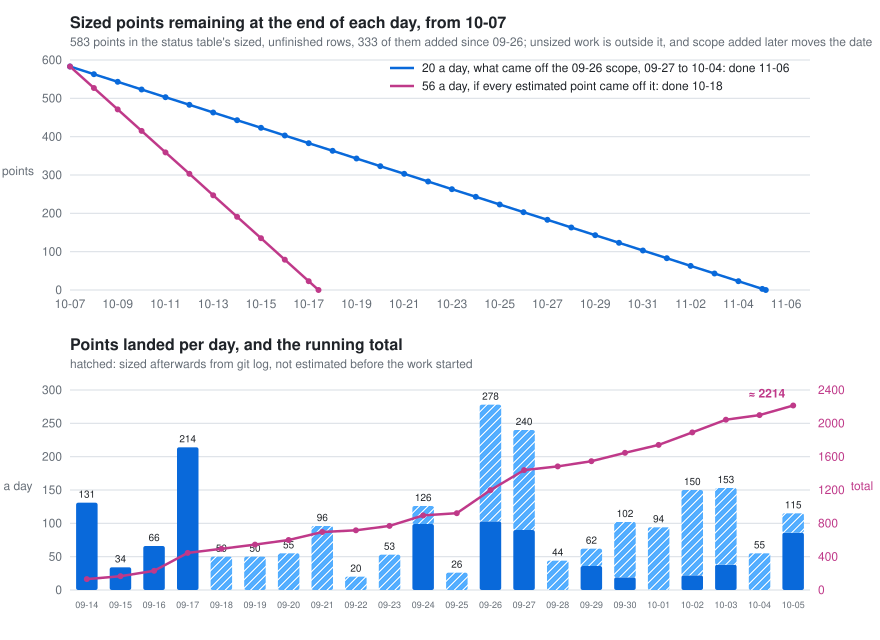
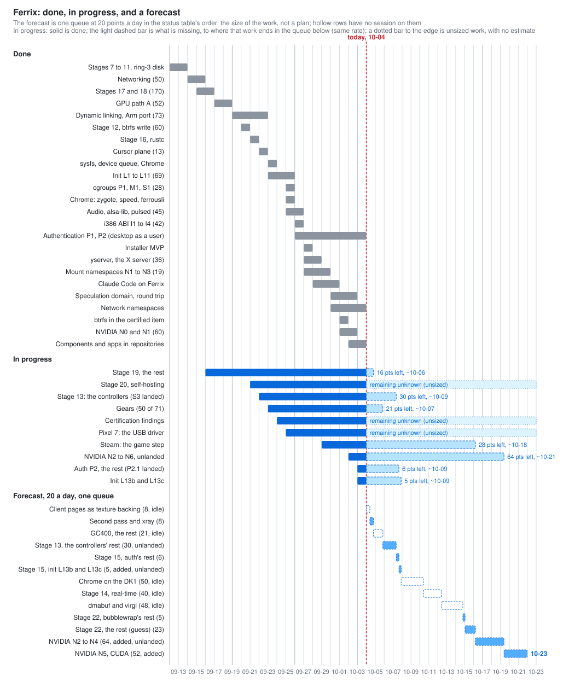

# Status, estimates and forecast

*Rows reviewed 2026-10-21, to `main` 2ba25d12a, against the landings since
d884add58 (the rows of stages 13, 21, 22 and 23, the installer, the Claude
desktop app, developing Ferrix on Ferrix, the desktop's clients, the
certification findings and the channel round trip changed, and two rows are
new, the N150 box with its Intel GPU, and the microkernel's M0 and M1; the
rest were checked against `git log` and have no landing to record); the velocity count and the
landed-per-day chart below still run through 2026-10-05, and the scope and the
dates of both charts are drawn at 2026-10-08.* Over the four days of
the points era that the fleet ran, 2026-09-14 to -17, about 445 points
landed: 131, 34, 66 and 214, which is ≈ 111 a calendar day and ≈ 150 a day
the fleet was running, with 8–10 sessions, 15–20 points a session-day, and
21 points a queue-hour on both days that were measured finely. Every
estimate under 8 held, and stages 17 and 18 came in at the sizes they were
given (`docs/BACKLOG.md`, *Velocity*). The count since then, to 2026-09-24,
is ≈ 870 points in 11 calendar days (≈ 79 a day), and 2026-09-24 alone
landed ≈ 99, about 22 an hour over the landing window, on a code base of
703 k lines of Rust. Counted again on 2026-09-26, the total was ≈ 1,200
points in 13 calendar days (≈ 92 a day). Counted again now, to 2026-10-01,
five more calendar days landed ≈ 542 points (≈ 108 a day of the days
counted this time), of which ≈ 145 were estimated before the work started
(the i386 ABI's 42, the sound stack's 21, authentication's phase 1 27,
yserver's 36, and N1 to N3 of Steam's namespaces' 19) and the rest, ≈ 397,
sized afterwards from `git log`, in clusters, the same way as before
(`docs/BACKLOG.md`, *Velocity*, "Update, 2026-10-01"). Counted once more, to 2026-10-04, three more calendar days landed ≈ 358
points (≈ 119 a day), of which ≈ 60 were estimated before the work started
(NVIDIA's N0 and N1) and the rest, ≈ 298, sized afterwards from `git log`
(`docs/BACKLOG.md`, *Velocity*, "Update, 2026-10-04"). Counted once more, to 2026-10-05, one more calendar day landed ≈ 115
points, of which ≈ 86 were estimated before the work started (NVIDIA's N2 to
N4 64, stage 20's S-2 5, FX-1012 6, the stage 10 seam panic 4, the Windows
gateway's peek 4, `bench-ipc` made exact 1, init's L13b 2) and the rest, ≈ 29,
sized afterwards from `git log` (`docs/BACKLOG.md`, *Velocity*, "Update,
2026-10-05"). The running total is
**≈ 2,214 points in 22 calendar days, ≈ 101 a day**, or ≈ 1,264 (≈ 57 a day)
counting only what had an estimate before it started. That is historical
velocity, not a current schedule, and not the rate the roadmap's scope
falls at: of the ≈ 1,015 points that landed from 2026-09-27 to 10-05, only
≈ 158 came off the scope sized on 09-26, ≈ 20 a day to 10-04 and ≈ 18 a day
counted to 10-05, since nothing of that scope landed on 10-05 (L13b, S-2 and
NVIDIA's N2 to N4 are rows added after it); the forecast keeps 20. The
*Burndown* below forecasts the sized scope, ≈ 518 points as of 2026-10-08, at
that rate.
The table records the state now.
Stages 12 to 16 were sized in words before points existed; their points are
first guesses rather than an owner's estimate and are replaced when a session
sizes them.

| what | points | current state |
|---|---|---|
| ~~Stage 19: the GPU path, Path A (`docs/GPU.md` §3)~~ *done 2026-09-19* | ~~52~~ | done |
| ~~Stage 19: the cursor plane (`docs/GPU.md` §3.10)~~ *done 2026-09-23* | ~~13~~ | done |
| ~~Stage 19: the device queue, commands in flight and a frame that waits once (`docs/GPU.md` §3.11)~~ *done 2026-09-24* | ~~13~~ | done |
| Stage 15, a real userland | *week* ≈ 20, of which job control is spent; most of the rest landed as zinc and uutils, and what is left is an init, sized at 67 points in `docs/INIT.md` §13, of which all 67 of L1 to L10 are spent, L11's 2 too, and 16 later; authentication (`docs/AUTH.md`, approved 2026-09-26): a kernel fix first (P0) 2, spent, phase 1 27, phase 2 31 and phase 3 about 32 later; init's L13, the sandboxing keys (10), of which L13a (5: `NoNewPrivileges=`, `PrivateTmp=`, `ProtectSystem=`) landed 2026-10-04, L13b (2: `PrivateNetwork=`) landed 2026-10-05 (3349682db), and L13c (3: `SystemCallFilter=`, with `SystemCallErrorNumber=` and `SystemCallArchitectures=`) landed 2026-10-08 (aae4c0eb1) | init done (L1 to L10, 2026-09-26): `run` and every desktop image boot `/sbin/init`, with `getty`, `svc`, readiness, socket activation, resource limits and the directory over `src/lib/init/svc`; L11 (`devmgr` on its restart policy) done too; L12 is later by design, and L13 is done, all three parts landed: L13a (2026-10-04, 1e1f2543a), L13b (2026-10-05) and L13c (2026-10-08, aae4c0eb1); authentication's P0 -- `process_create` gave a child root's credentials -- is fixed (2026-09-26), and phase 1 is done (hyprlock's lock goes over `authd`, 2026-10-03); phase 2, the desktop as a user, is done but for K-C (P2.2, not started): `getty`'s revoke of the console before every login (0f94a6d1a) and K-B (P2.1, NP, 7e9a2806f) landed 2026-10-04 |
| ~~Stage 19: an X server, XWayland's 40~~ *done 2026-09-29 as yserver (`docs/YSERVER.md`)* | ~~40~~ 36 spent | done |
| ~~Stage 13, namespaces, cgroups, seccomp~~ *done 2026-10-14 on its exit criterion* | cgroups 85 (`docs/CGROUPS.md` §7: 27 for what init needs, 58 for the controllers); namespaces and seccomp unsized, the old guess for the whole stage was *month* ≈ 60 | done: the exit criterion is met (below; its scope is what `main` holds, and the rest is the [follow-ons](follow-ons.md)). As of 2026-10-04: mount, user, UTS, IPC, cgroup, pid and network namespaces are in (network: 22384874f); seccomp filters (S3) landed 2026-10-04 (248799bdd); G1 to G5 done (27), which is all init needs from it, C8 for native services included; `pids`, `memory`'s charging and `cpu.weight` done (2026-09-26, as the certification's job quotas), and `memory`'s scoped OOM kill the same day (P1, M1, S1: 28), so 55 of 85, and the controllers' last ≈ 30 landed 2026-10-07 (08984c2db..8ec24ef0e, `po6/cgctl` rebased by po10-cgctl): `memory`'s reclaim of a read-only mount's clean pages and `memory.high`, `memory.stat`'s `file`, `kernel`, `shmem`, `pgscan`, `pgsteal`, `pgfault` and `pgmajfault`, `cgroup.freeze`, `cpu.max` with `cpu.stat`, and the `io` controller with `io.max`, 23 negative controls fired, the fast path's exits held to `cpu.max` as the general way out is, and on 2026-10-08 (df7ee418c) `cpu.stat`'s charge, which the controllers made a walk up the job tree at every direction of the fast path, is kept back in a run queue's own record (`quota::Pending`, L.object.180) and moved into the jobs' slots once, when the queue charges another job, switches to a task of another job or to idle, moves its running task to another job, or `cpu.stat` is read, and `cpu.max`'s walk is made only while some `cpu.max` is set; Steam's user and mount namespaces sized at 39 (`docs/NAMESPACES.md` §9), N1 to N3 done (19; N3 took `openat2` besides, which bubblewrap 0.12 needs); seccomp's S4 to S6 (`SECCOMP_RET_TRAP`, `TSYNC` and `test-seccomp`) are on `main` since 2026-10-18, ported on 2026-10-11 (`docs/SECCOMP.md` §12); `test-container`, the exit criterion as one program, is on `main` since 2026-10-14 (f231cdf09) and passed on all three architectures (`docs/CGROUPS.md` §15), so the stage's exit is met; a writable mount's clean pages are reclaimed since 2026-10-15 (f0bc9ab2d, L.object.188-190: the work of the branch `mm-pcache`, landed under another hash); Syscall User Dispatch (`prctl` 59, for Proton's Wine) is on `main` since 2026-10-18 (`docs/SECCOMP.md` §13); the follow-ons, not built, are time namespaces (the branch `stage13-timens`), reclaim of the dentry and inode caches, unprivileged mounting (N5, on a branch) and Linux's `seccomp_bpf` selftest |
| Namespace and cgroup follow-ons ([their page](follow-ons.md)): what stage 13 was first written to hold and `main` does not: time namespaces, unprivileged mounting (N5), the dentry and inode caches' reclaim, Linux's `seccomp_bpf` selftest | unsized; not in the sized scope the burndown is drawn on | not started on `main`: branches `stage13-timens`, `stage13-n5` and `stage13-bwrap-user` hold part of it; `memory.reclaim`, `cpu.max.burst`, `cpu.idle`, `io.weight`, `io.latency`, and `anon` and `pagetables` in `memory.stat` are built (2026-10-26, L.object.182 to 185) |
| `run-compositor --everything` carries everything: every volume, every app, nothing silently left out (the customer's rule, 2026-10-01) | unsized | under way: the volumes are fetched when missing, and a failed fetch stops the run (f7777c17, 2026-10-01); Steam in fuzzel (cb21ecd8); on 2026-10-05 the volume's X11 link took the place of the xkb placeholder (cf30aa08f; the command had failed on `main` with kernel panic FX-0801) and component checkouts on Windows keep their own objects and LF files (0d7520d82, 1752580c1); every app and btop built on Windows are os-3c's, next; on 2026-10-08 on the Windows PC (06253d284, with c8d5bbad3, 9298584b0, f11409d4c and the ferrousli pin 09086c4db): the guest has four processors under WHPX, where QEMU 11.1's own x86 emulator answered "not mapped" to a page walk with more than one (a patch, `tools/common/data/qemu/0005`, has it ask Hyper-V; only a QEMU that says `ferrix: whpx-gva` gets more than one), the window-slide animation's slowest frame fell from 112-116 ms to 25-32 ms and a 1920x1080 GL desktop's mean frame from 12.1 to 6.5 ms; a window takes the GPU by default; `run` and `run-compositor` start a watched QEMU above normal priority (on a busy PC 61 frames a second at the median and 60 at the 10th percentile, where normal priority gave 10-45 at the 10th); a first xtask command stopped while it cloned a component no longer breaks the next one; the scripts of `bench-chrome`, `test-xwindow` and `run-steam` boot ferrousli's own busybox where Alpine's static one is missing; and uutils is installed where xtask looks, so a boot stops rebuilding it for minutes (measured on the Windows PC, one run each; the vdagent's reconnect loop is a BACKLOG row) |
| The desktop's own clients: waybar, fuzzel, hyprlock and hypridle in Rust, reading the customer's own files (`docs/DESKTOP-CLIENTS.md`) | the foundation they share 21 (`docs/BACKLOG.md`); the four programs unsized | under way: the foundation's crates and hypridle on `main` (2026-09-26); waybar, drawing the customer's bar on the desktop, and fuzzel's window, run by their launcher script, on `main` and gated by boots (2026-09-27); hyprlock checks a password through `authd` on every desktop (2026-10-03); since 2026-10-04 hypridle, hyprlock, waybar, fuzzel and term are apps in `ferrix-os/apps`, built by xtask from their folders, and foot takes keys (every compositor image carries libxkbcommon's `xkb` directory; `test-foot`'s typed-line check runs since f55e8ab28, 2026-10-04); a `settings` app and the `compositor-desktop` crate fuzzel now stands on landed 2026-10-11 (2068a3abb, `docs/SETTINGS.md`): its settings are marks with no effect yet, and the first privileged effect, the speculation protections and the other latency trades, waits on a design round (`game-mode-design`) |
| Certification findings (`docs/certification/FINDINGS.md`), the work inside the repository | 160 left of 165 (range 130-210, mostly guess): C1 debt after landings 10 (firm), 5 of it spent, C2 to C4 F-56's btrfs evidence 10 + 11 + 8, C5 to C7 F-15 and F-16 low-level requirements 24, C8 to C10 F-14 checks with controls for the 322 baselined requirements 33, C11 and C12 F-10 coverage 16, C13 F-18 and F-19 generator and coverage-tool verification 10, C14 coding standard and a change-impact gate 10, C15 the planning set 13, C16 EAL5 design evidence 13, C17 F-43 and F-52 8 | in progress; on 2026-10-21 the register stands at 28 open and 62 closed, of 90 (its own count in `docs/certification/FINDINGS.md`), the new ones from the customer's N150 box and its first boots (F-79 to F-85: `CR0.NE`, the breach check's subjects, a bridge as the block ring check's subject, RFDS and BHI), btrfs under memory pressure (F-86 to F-89, open), the page cache dropped whole (F-90), seccomp `TSYNC`'s holds (F-72, open), a lost wake in a pipe wait (F-77) and a throttled task's wake-ups (F-78), and F-73 (nothing set `CR4.MCE`) and F-64 (`forget_root`'s second store) closed on 2026-10-21; 2026-10-08, on `main`: F-66 (Major, ARMv7-A's `TPIDRURW` reaching the next program), F-68 (Minor, a Thumb program's `SIGILL` naming the halfword before the instruction) and F-69 (a wait's last look preempted, its wake lost) filed and closed, and F-65 earlier that day, so the register stood then at 17 open and 52 closed, of 69; 2026-10-07, on `main` (f8b44e04c, C1): seven verification-audit rows closed by runs on `main` 4066f41dd (the four N4 negative controls fired; `test-xwindow`, the musl and glibc busybox `test-shell`, the musl `test-vfs`, `test-badapple`, `test-apps` and ferrousli's tests passed; the Finder's boots had passed in an earlier batch on the same commit), and two roadmap sentences the rows named as wrong corrected; the audit's other rows stay open (37 code landings that name no gate, the untriaged mutants), and the 5 left of C1 are a guess at what they take; 2026-10-05, on `main`: F-62, a carry nobody made, filed and closed (the gate now fails on it), the item's load ring refuses a member that matches no file, and F-63, the chardev queue's bound, filed and closed; excluded, and not counted: freedom from interference across ring 0 (90-160, a row of its own), F-13 and ISO 26262; the steps outside the repository (the pre-assessment, the QMS F-28, independent reviewers F-27, Ferrocene F-17, a CC lab) carry no points |
| Stage 21, bare metal and a GPU of Ferrix's own | over 100, unsized | under way on NVIDIA's own driver (`docs/NVIDIA.md`): N0, the kernel prerequisites, and N1, `nvrm` booting the RTX 3060's GSP with `nvidia-smi`, are on `main` (2026-10-03), and the chardev core's queue bound (F-63) with stage 10's chardev self-check (N10's code half, N12, N13) since 2026-10-05; N2 to N4 (`vulkaninfo`, Chrome's WebGL) and N6 (the desktop on the customer's TV over HDMI, 1920x1080@60, with host keyboard and mouse passed in) landed on 2026-10-05 as `land-n6` (a84992dc5, batch 20261005T190105Z); `nvidia-n2`'s tip does not build; N3b's kernel half is on `main` since 2026-10-11 (the chardev render node and VMO dmabufs 1320c4345, name-only dmabufs of video memory, which `nvrm` exports, b05d045c9, `sync_file` fences 74ba209a3), with hyprix's `zwp_linux_dmabuf_v1` of 2026-10-08, and an empty slot's fence resolves as signalled since 2026-10-21 (8777e90f9); hyprix drawing on the card (N3c's vtest renderer, branch `nv-zerocopy`) and an X program's window drawn by the card (`nv-next`) are still branches, so next are those, a hardware cursor, and measuring page loads; the same stage now also holds the customer's N150 box and its Intel GPU (the next row) |
| Stage 21: Ferrix on the customer's Intel N150 box, the machine for stage 23's anti-cheat, and a render driver for its Intel GPU (`docs/N150.md`, `docs/INTEL-GPU.md`, `docs/AHCI.md`, the customer, 2026-10-13 to -18) | unsized; not in the sized scope the burndown is drawn on | under way (2026-10-21: `/` is on the box's drive again after an unpack fix, 94d6c39fa; the pstore says how the last boot ended, a0025e505; a lockup detector and the PCH watchdog are designed, 68cc4a702; the Intel GPU has i915's frequency policy, 2ba25d12a): Ferrix, built from the branch `ahci` (4a0db8a97), booted on the box on 2026-10-15 to hyprix on the firmware framebuffer, `/` on its SATA drive and the network up, `gryphlink` showing the launcher, nothing logged into; on `main`: the AHCI driver (ee2d5bf0f), the YT6801's network driver (3f4769222; the box's NIC and USB still poll, since the YT6801's one MSI arrives rarely and xHCI's none: BACKLOG), `efifb`, hyprix on the firmware's framebuffer with no GPU driver (c7d81aeef) with the framebuffer write-combining from its first map (95d9bba44, e23cf49ca), a PC's xHCI controller under `usbhid` (4043a62db), an NVMe driver (750622eb6; it has driven a real WD SN720 through VFIO and installed Ferrix onto it), x2APIC mode and a CPUID clock fallback (a05192a23, 343a988c9), Intel HWP at bring-up (134cf560f) and `ferrix.epp`, SMBIOS shown in sysfs as Linux does (DMI D1, 4b8531886), the kernel log kept across a warm reset and an event-log partition that keeps panic reports (PM3 d01fbfed1, PM4 ca31a22ac, 630bb9b42), `ferrix.panic=reset` (02fdb1df6), VT-d driven on the box's two units (16e113583) and an RMRR honoured with a kernel-held identity domain (K2, a1c5d897d, 2026-10-20), and the defences the box's Linux showed missing, RFDS and BHI (6873221d6, F-84, F-85); the kernel bring-up is evidenced on QEMU only, not yet run on the box with checks on, and F-80, F-83, F-84, F-85 await a hardware run; the Intel GPU's driver (design OK IF, ledger 2352): the kernel's render-only chardev node, the screen lent by identity, write-combining mappings and sync-file fences for a dmabuf slot (K3 to K6) and `intel-xelp`, the i915 user-space interface over a back end, are on `main`; on the box, M1 (the device answers) and M2 (the GT's bring-up and the first GPU commands, a blit exact by hash) ran on 2026-10-20, M3's driver serving the render node is wired (6ae77e2d1) and not yet shown on the box, the box hung twice under `ferrix.intelgpu` (first cause found 2026-10-20), and the first Endfield run on the iGPU is prepared (the launcher on lavapipe, only the game on anv, 237c055e8) |
| Stage 22, Steam: the parts with a first guess (bubblewrap's rest 13, sound 30, Venus 8; glibc's names are dynamic linking's 13 and XWayland stage 19's, both counted above) | 51; sound re-sized by `docs/AUDIO.md` as 24 for the driver, the core and a gate, spent, then alsa-lib 3 (U1) and a server unsized (U2), so 24 of the 51 left sized | sound done: playback 2026-09-26 -- a ring-3 virtio-snd driver, the audio core, `/dev/snd`, `test-audio`, Chrome playing through it, and `run-compositor --everything` bringing the card -- then alsa-lib (U1) and `pulsed`, the PulseAudio-protocol server (U2a to U2d, 18 points), 2026-09-27; bubblewrap waits on namespaces (N1 and N2 done, see stage 13; its rest re-sized on 2026-10-05 from 5 to 16 after the consultant found B1 and B2, and N5 and `bwrap-user` are parked on branches); Venus not started |
| ~~Dynamic linking: the kernel half, ferrousli's loader, glibc's names~~ *done 2026-09-23* | ~~39~~ | done |
| ~~Dynamic linking: ferrousli's AArch64 and ARMv7-A port, which the customer put inside the stage on 2026-09-21~~ *done 2026-09-23* | ~~≈ 34~~ | done |
| ~~Stage 12, btrfs write~~ *done 2026-09-21* | ~~≈ 60~~ | done |
| ~~sysfs, fed by the services that own each fact (`docs/SYSFS.md`)~~ *done 2026-09-24* | ~~26~~ | done |
| ~~Chrome on Ferrix, headless and in a window, x86-64 (`docs/CHROME.md`)~~ *done 2026-09-24* | foot and its ports 13, the kernel's rows ≈ 30, spent | done |
| ~~Chrome: the zygote, its speed, ferrousli in glibc's place headless and in a window, the persistent btrfs root~~ *done 2026-09-26* | unsized, spent | done |
| ~~Chrome: `inotify`~~ *done 2026-09-27 (ferrix-e4)* | unsized, spent | done |
| Chrome: the GPU | unsized | under way on NVIDIA's card (stage 21): WebGL renders on the RTX 3060 through ANGLE on NVIDIA's Vulkan, 44–53 fps with software compositing; on `main` since 2026-10-05 (`land-n6`); dmabufs for GPU compositing (N3b, half built on `nvidia-n2`) next |
| Stage 19: the desktop's speed as it is watched (`docs/GPU.md` §3.9): client pages as texture backing | 8 | in progress |
| ~~Claude Code on Ferrix, the command line, x86-64, and `claude` on the `--everything` desktop (`docs/CLAUDE-CODE.md`)~~ *done 2026-09-30* | unsized, spent: the volume and gate, and `XSAVE` in the kernel | done |
| ~~Claude Code: the interactive TUI gated, the launcher, Zenbleed and GDS~~ *done 2026-09-30* | unsized, spent | done |
| ~~Claude Code on ferrousli, as the `--everything` desktop runs it: the POSIX timers, the gate on ferrousli~~ *done 2026-10-01* | unsized, spent | done |
| Claude Code: a real account, the i386 frame's AVX state (AArch64 done 2026-10-15) | unsized | not started |
| The Claude desktop app: Anthropic's Linux build, a beta since 2026-07, natively as Chrome runs (`docs/CLAUDE-CODE.md` §7) | 12–18 to run it with sign-in by hand (C1 to C4), ordered by the customer on 2026-10-14 and so in the sized scope from that day (the burndown is redrawn at the wind-down); C5 to C7, a kept sign-in and notifications, 9–15 more as first guesses (21–33 in all), not yet ordered | C1 to C4 built 2026-10-15 and on `main` since 2026-10-16 (d787e7991, b6f7667ca; about 6 points spent): the app shows its sign-in screen on the `--everything` desktop, natively on ferrousli, after ferrousli's loader learned `DT_RPATH`; `cargo xtask test-claude-desktop` (§7.8); C6's Secret Service will be served by `authd`, not by gnome-keyring |
| The Pixel 7, the customer's phone (`src/boot/vendor/google/pixel7/HANDOVER.md`) | the desktop in the launcher app's VM done; the USB device driver done (2026-09-26); what remains of USB 37 (range 30-50: U-1 robustness 5, U-2 onto `ferrix-driver` 5, U-3 input over the port and a shell on ttyACM 8, U-4 LPM and suspend 5, U-5 SuperSpeed through the Tensor combo PHY 13, which could be 21; all but U-0 need the phone) | under way: `main` boots it natively on all eight cores to `FERRIX-BOOT-OK stages 1-12`, and as a guest of the phone's own crosvm from a launcher app, with a monitor graphing the boot and `ferrix-statd`'s samples (2026-09-26); the customer chose the VM for a desktop the same day (option A), and it runs there with Chromium on it (2026-09-27); the USB device driver landed 2026-09-26, a CDC-ACM "Ferrix console" (1209:0001) carrying the boot log and `ferrix-statd`'s samples, and adb over the same port on 2026-09-27 (`docs/vendor/google/pixel7/USB-HANDOVER.md` §8) |
| ~~Stage 19: `dwindle:precise_mouse_move`, the second-pass effects and the window rule `xray`~~ *done 2026-10-07 (po10-win19, bab9eed1c, landed in batch 64f01d596..eb4c8dc2e)* | about 8 | done: the window rule `xray` and `decoration:blur:xray`, `no_screen_share` in every screenshot path, `blur_popups` and `decoration:blur:popups`, and a tiled window dragged with `movewindow` dropped back into the tiling, with `dwindle:precise_mouse_move`; none needed a second render pass; `test-compositor --boot drag`, `drag-precise`, `bar-menu`, `screenshot-unshared` |
| Gears (`docs/GPU.md` §6, the customer's order of 2026-09-24): vkgears through Venus on the Linux host 39, which is also stage 22's "Venus 8" and more; GLES2 gears on the DK1's GC400 32 | 71 | under way: vkgears draws through Venus (39 done, 2026-09-24); the GC400 runs a command buffer on the board, its events by interrupt (G1 and G2, 11 of its 32, 2026-09-24) |
| Stage 22, Steam: the 32-bit x86 ABI and what the runtime and Proton find missing | unsized, ≈ 100 as a guess; `docs/I386.md` sizes I1 to I4 at 42, I5 unsized | under way: I1 to I4 done (42 of 42): 32-bit programs, their threads, signals and fork, and Alpine's and Debian's i386 busybox; I5a, Valve's `steamcmd` logging in, 2026-09-27; yserver, the X server, 36 points, 2026-09-29; Steam's sign-in window on hyprix through yserver 2026-09-29; the client signs in and shows its store on the `--everything` desktop under ferrousli, gated by `test-steam-store`, 2026-09-30; launch-side workarounds left (`docs/STEAM.md` §3), the GPU process's route designed, 14 to 23 points (§6); a game from the library gated by `test-steam-game`, 2026-10-01, not passing then: the install downloads and then stalls staging, cause not yet known (§7); since 2026-10-10 a library game can be started around that stall: `--steam-preinstall` installs Teeworlds and its runtime with `steamcmd` on the host and merges them into the volume (ee9eade0b), and `ferrix_direct`, a compatibility tool, starts a native game outside pressure-vessel (3a2740642), which stays waiting on N5 to N7; the customer reports (2026-10-21) that Steam runs on Ferrix and that a game has also run; the gate's own result and log are not recorded in `docs/STEAM.md` |
| Stage 23, Arknights: Endfield through Wine with DXVK on NVIDIA's Vulkan ([its page](stage-23-arknights-endfield.md); the customer, 2026-10-10) | ≈ 205 as a first guess, 74 of them guesses at what running it finds: step 0 the game on Linux in the same VM shape 8, step 1 Wine starts on Ferrix 42, step 2 Direct3D 11 through DXVK on the card 18, step 3 a Unity DirectX 11 game without anti-cheat 54, step 4 installer, launcher and login 25, step 5 past the anti-cheat 29 (unknown), step 6 playable at 1080p60 29; step 7, by way of Steam, is optional, 13 and stage 22's N5 to N7; stage 21's unlanded GPU branches are under steps 2, 3 and 6 and counted in none; not in the sized scope the burndown is drawn on | in progress: step 0 answered on 2026-10-13 (the game downloaded on the Linux guest and its anti-cheat refused to run in a virtual machine, so steps 4 to 6 wait for Ferrix on the machine; whether it accepts Wine on bare-metal Linux is not known); step 1 (Wine starts on Ferrix, its notepad is a window of hyprix's, 32-bit Windows programs run in its 64-bit process and draw a window: `test-wine`; Proton's Wine waits through fsync on the new `futex_waitv`, 2026-10-15: `test-wine-sync`); the card-free half of step 2 (`test-dxvk`); the first half of step 3 (`test-unity`, at about 1.3 frames a second with no card); step 4 begun: Endfield's launcher reaches its server and draws its install dialog in Debian's Wine and in GE-Proton11-7's (`test-endfield-launcher`, `test-endfield-proton`, 2026-10-14; Proton needed `mprotect` to keep a mapping shared and a write-only region to read, f0c812f01), the download's certificate roots are in (GnuTLS and the CA bundle where Wine's crypt32 reads them), and Wine, Proton and the launcher are on the `--everything` desktop as `gryphlink`; the game's download is not done: it stopped on ENOSPC from Ferrix's btrfs after about 5.8 GB with about 150 GB unallocated, because the 8 GiB guest ran out of frames and a writable mount's page cache is not reclaimed; the fix, reclaim of a writable mount's clean pages with the cache's totals in `/proc/meminfo` (L.object.188-190), is on `main` since 2026-10-15 (f0bc9ab2d, the work of the branch `mm-pcache` under another hash), and no download has been run on it since; on 2026-10-15 a download on a scratch image (install5, 4 vCPUs) reached about 9.5 GB of 56.9 GB at 2.5 MB/s and died at 00:22 when the guest's virtio-net driver stopped sending after two `devmgr` restarts (the net ring's shared indices were composed from bytes and tore; every one is a single aligned access, and a ring the kernel ended makes the driver leave, since 2026-10-15: 36a1bea84, 11d006073, bdccab15d, the work of `net-restart-stall`), and the launcher's looping background video, not the download, was taking about 2.6 of the 4 vCPUs (a click on its STATIC switch pauses it); a next download (install6, 8 vCPUs, a fresh image, scratch branch `ef-night`, never for `main`) runs at about 3.7 MB/s; a restart starts the download over, since the launcher keeps its state in a Wine prefix on tmpfs, unless the prefix is kept (`ef-night` keeps it on the volume; unproven); the card steps wait on stage 21's unlanded GPU branches; on 2026-10-15 Ferrix booted on the customer's N150 box from branch `ahci` (4a0db8a97; its kernel bring-up on `main` since the n150k landing (ledger 1884), evidenced on QEMU only and not yet run on the box with checks on (BACKLOG); `docs/N150.md` §13): desktop on the firmware framebuffer, `/` on its SATA drive (`docs/AHCI.md`), the YT6801's network, `gryphlink` showing the launcher online; not logged in, nothing downloaded, slow (uncached framebuffer then, polling without MSI); since then, on `main`: the framebuffer is write-combining, Syscall User Dispatch and S4's `SECCOMP_RET_TRAP` are in for E5.3 (`test-sud`, `test-wine-dispatch`, 2026-10-18), and the launcher is drawn without OpenGL (b147e0318); the box's GPU route is the Intel GPU's driver (stage 21's N150 row), and its first Endfield run is prepared, not made |
| Stage 24, the game path: a fullscreen game faster on Ferrix than on a stock Linux desktop ([its page](stage-24-game-path.md), `docs/GAME-PATH.md`; a stage by the customer's decision, 2026-10-10) | ≈ 68 before the game domain, the design's own first guesses (§8): the rig, R1 to R5, 19 to 21, then the first cut, 47 (the flip's time P1 8, the game lane P2 8, input I1 5, tearing P6 5, just in time P7 8, the session with what exists G0 8, drawing backwards from the deadline P5 5); the game domain, G1 to G5, 52, is stage 14's ground and not in the 68 until the customer decides; later rows 73, each built only on a measurement; about 190 in all; displayctl v9, yserver's dmabuf hand-over and the hardware cursor are other sessions' and carry no points here; not in the sized scope the burndown is drawn on | in progress: the design is written (2026-10-10); step 1, the rig, has three of its five rows: R1, the frame recorder (`test-frames`; 5 points estimated, about 7 to 8 spent), and R2, the input-to-scan-out probe (`test-xlatency`; 5 estimated, about 4 spent), and R3, the load, the timed sleep, the busy shares, the launch timer and both guests pinned with an invariant TSC (`test-game-rig`; 3 estimated, about 8 to 9 spent), all on 2026-10-14 and all with no card, the same binaries run on Ferrix and on a Linux guest; R4 and R5 need the card; of step 2, I1, input's time carried end to end and hyprix's input thread (`test-compositor --boot lane`, per-hop ages in `test-xlatency`; 5 estimated), on 2026-10-15; nothing is measured on the card yet; yserver's Present clock now keeps one refresh (pin d2bf56e2, 2026-10-15, e34851de3): an msc lasted 12.2 to 19.4 ms at the old pin and is 13.334 ms in every msc of six records, and `test-frames` fails a clock whose longest msc is more than 1% of a refresh longer than its shortest (e31ba0c8e; `docs/GAME-PATH.md` §12); the rest on the card waits on stage 21's unlanded zero-copy work, and nine of the design's ten questions are open |
| Stage 25, Yoru, the main UI: the customer's design "Yoru WM" as the desktop's look and shell on hyprix ([its page](stage-25-yoru.md), `docs/DESKTOP.md` §6; the customer, 2026-10-24) | 63 as the design's own estimate (Y1 5, Y2 8, Y3 3 + 5, Y4 8, Y5 13, Y6 8, Y7 8, Y8 5), the Files app unsized; not in the sized scope the burndown is drawn on | in progress: Y1, Y2 with its stash, Y3's launcher look, Y4's sidebars and Y7's wallpaper picker are built, each with a `test-compositor` boot, and so are Nocturne for GTK, `portald` and Chrome's GTK volumes (2026-10-25); to do: the palette, snapping, the helpers, accent from the wallpaper, lock, notifications and switcher in the tokens, the weather and quick settings, and a Files app |
| Developing Ferrix on Ferrix (`docs/DEV-ON-FERRIX.md`, the customer's request of 2026-10-10) | D0 5 spent; D1 to D11 about 60, half of them guesses, and D6 inside the live driver updates' 26 | under way: the loop walked on the `--everything` desktop and D0 on `main` (2026-10-11, 8794e19c6) -- a Rust panic unwinds on ferrousli, `cargo xtask test-devloop` with two controls, rustfmt, clippy and rust-analyzer in the toolchain's fetch script, and the gateway's handshake timer; D1 (helix and rust-analyzer on the volume, c4cdd75e1; its `PATH` step is not in), D5 (`pkg install --replace` and `cargo xtask install-app`, 63bfc5525) and D8, the A/B system slots (`docs/AB-BOOT.md`: the loader's trial boot with a way back, 779e80ea2; `bootctl` and `ferrix-install --slots`, e49947728; `cargo xtask test-ab-boot`), are on `main` since 2026-10-11, and D9 was measured (QEMU runs on Ferrix and does not end on its guest's power-off); next D2 to D4, D6, D7, D10, D11 and the six decisions of its §9 |
| The installer (`docs/INSTALLER.md`, approved 2026-09-28) | the MVP and I6a (5) spent; the rest in §9 | under way: the MVP, `ferrix-install` onto a VM's disk and `test-install`, 2026-09-28; I6a, the live medium on a GUID partition table (`xtask live`), 2026-10-07; a netboot for a bare-metal PC, `cargo xtask netboot-stick` and `netboot` and the gate `test-netboot`, 2026-10-15 (`docs/NETBOOT.md`, da37eb541: an iPXE stick takes the PC's firmware network driver and boots what this host last built, with nothing written to the PC's disk; proven under OVMF with a virtio-net card, not yet on a real PC); I3, the root volume made to its partition's size by `ferrix-btrfs-mkfs`, 2026-10-19; the drivers a PC needs, on `main`: NVMe (H1, 2026-10-11; it has driven a real WD SN720 through VFIO and installed Ferrix onto it), a PC's xHCI controller with bulk-only disks (H3, 2026-10-10; such a disk is not yet served to the block core) and AHCI (2026-10-15); `ferrix-install` finds a live medium's partition before a bare image (a95473469); the first numbered release, v0.1.0 (tagged 2026-10-20), built none of its assets and v0.1.1 (2026-10-21, `docs/RELEASES.md`) carries the x86-64 desktop as a zip that plain QEMU boots, with a licence inventory and the sources of its GPL programs; `cargo xtask test-install` fails on `main` in the live medium's boot (a BACKLOG row, 2026-10-19; 0d9f41949 changed `ahci`'s exit on a machine with no ATA disk and the row is not closed); the ISO, the boot menu, the graphical installer, Secure Boot, shrinking and real PCs left |
| Stage 14, real-time domains | *month* ≈ 40 | not started |
| After stage 19's 178: `zwp_linux_dmabuf` with a GBM-shaped allocator, and Mesa's virgl on ferrousli, for clients that draw on the GPU themselves (`docs/BACKLOG.md`) | 8 spent, and 40 or more | under way: `zwp_linux_dmabuf_v1` in hyprix and the GBM-shaped allocator done, a client's GPU buffer sampled where it lies (built 2026-10-07, landed 2026-10-08 in 03fce4f81, `docs/GPU.md` §3.13); Mesa's virgl on ferrousli not started |
| ~~Stage 16, `rustc`~~ *exit met 2026-09-22* | ~~*the goal* ≈ 40~~ 8 spent | done |
| Stage 20, self-hosting | 45 left (range 40-75; S-0, CI green, and S-2, plan mode complete, are met): S-1 FX-0001 under load 8 (3-13, a guess), S-3 the whole 188-build x86-64 plan on Ferrix 8, S-4 the script apps' toolchain 8, S-5 Arm toolchains in the guest 6, S-6 replay all 57 rows from the Ferrix store 8, S-7 the weekly CI workflow 5, S-8 the exit record 2 (S-8 firm, the rest guesses); not counted: if "three architectures" means the compiler runs on ARMv7-A Ferrix, 13 or more | in progress: the x86-64 image builds on Ferrix and boots (2026-09-23); the AArch64 image builds on Ferrix on the Pixel 7 and boots (2026-10-03); every build of the matrix recorded, Ferrix making them stops on FX-0001 (2026-09-24); 2026-10-04, on `main`: one kernel for every test, each test's init program and script in the initramfs under `.ferrix/init/` (the plan falls from 271 builds to 188), a 57-row matrix, and a plan mode that records builds without booting (`selfhost-matrix`); the volume carries the components and the guest clones none, which fixes CI's "rustc on Ferrix, and Ferrix built on Ferrix" job (`selfhost-components`, cb872a732; CI's job has passed on `main` since 77783565a); 2026-10-05, on `main` (ce133294c, a3b240c6b): the plan is complete, `test-threads`, `test-procfs`, `test-display`, `test-input`, `test-audio`, `test-badapple` and `test-compositor` build every variant before their first boot (162 distinct builds against 139); 2026-10-07, on `main` (90108e87a): S-1's fix, a late TLB-shootdown answer is waited for and counted, and the machine stops only past 10 s (FX-0001), shown on a starved host without loading it; whether the whole plan now finishes is S-3's question; owed: a weekly CI job, and the apps and Arm C programs built by Ferrix |
| Chrome on the STM32MP157D-DK1 (`docs/CHROME.md` §10) | ≈ 45–55 | under way, on `main`: Debian's armhf Chromium on a volume, and under QEMU on ARMv7-A it runs headless in 512 MiB (version, a page's script, a screenshot), after ARM's `send`/`recv`, `cacheflush` and `mmap` of a read-only btrfs were fixed (built 2026-10-07, landed 2026-10-08 in aae4c0eb1); the volume cannot live in the board's RAM (an initramfs costs twice its size), so the card has a driver, `sdmmc`, a ring-3 process behind the block ring that moves every word through SDMMC1's FIFO with no DMA and writes only inside `ferrix-*` partitions (13 points, 03fce4f81, 2026-10-08: 22 host tests against a model of the controller and the tree disk's boot check, and no emulator has the controller); the page cache gives back a read-only btrfs's clean pages since the cgroup controllers landed (2026-10-07), and a kernel frame reserve is designed, not built; nothing has run on the board: `jitflush` for `cacheflush` and the card, read-only first, wait for the product owner's word |
| Live driver updates: a new driver version without a reboot. `devmgr` starts a driver it restarts from a new, verified image instead of the initramfs copy, and goes back to the old one if the new one does not publish (the customer's question, 2026-10-05; `docs/DEVMGR.md` §4) | 26, a first guess: D1 a new image's way into `devmgr` (every driver image comes from the initramfs today) 8, D2 the update command and the rollback 5, D3 the image's verification and the certification review 5, D4 `test-restart --update` for each kind with its negative controls 5, D5 requirements and docs 3; the kinds `devmgr` does not restart today (the serial port, the USB host, the GC400 engine, the USB gadget, a GPU under `nvrm`) and `devmgr`'s own restart (`docs/INIT.md` L12) are outside it | in progress; landed 2026-10-08 in aae4c0eb1: the design (`docs/DEVMGR.md` §4.1) and the certification consultant's verdict on it (OK if C1 to C10, 2026-10-07); D1, D2 and D4 built for the display kind (f2240e206: `drvupdated` and `/bin/drvupdate` hand `devmgr` an image, which it decodes again, fingerprints with FNV-1a 64 -- that identifies bytes and proves nothing against an adversary -- and makes a process from in a scratch job that is never started, before it stops the running driver; the old image is started again if the new one does not publish in 15 s), and the reference configuration (`driver_updates` is `absent` in a claimed configuration and `test` for `test-restart --update`'s images), AoU-26 and the model (a817ba2f1); D3, the image's verification, is owed, so `drvupdated` is in test images only until the customer answers how a new image is to be signed, and a claimed configuration carries none; what it builds on, restarting a display, sound, network, input or disk driver with its device's state kept, is done (T0, 2026-09-27, `cargo xtask test-restart`) |
| The native channel round trip as fast as seL4's, 440 ns on nazuna with matched protections (`docs/OPAQUE-KERNEL.md` §9.5 to §9.11, its progress and chart in [the round trip's page](ipc-round-trip.md), the customer, 2026-10-02; under 400 ns since 2026-10-06, §9.10) | 10 left of the 69 (range 60-90), which is step 5's squeeze by the profile, 5-11 (§9.5); 2f, step 3 without PCIDs and step 4's fast path, 59, landed 2026-10-06; step 3's PCIDs (10-13, nazuna has none) and step 4b are outside it | under way: on `main`, step 1, F-60's fix, 2a to 2f (445d09420), 3a and 3b (a1d456820), step 4's direct switch and fast path for `channel_write_read` (0edd644b2, with 0c02066d7; behind `ferrix.fastpath=on`, x86-64 only, off in the certified configuration for the first release), and step 5's ERAPS (3b9b1e267) and vector reset (80f32db1f), all 2026-10-06; on 2026-10-07 the round toward seL4's figure: the DS and ES skip (690754979), the object side's cut 1 (69cf2754c) and cut 2 (523eeccc6, 7b06cef25), link-time hooks for the entry and T2 (4066f41dd) and a task's slots as atomic cells (f6627521c). On the evening of 2026-10-07 and on 2026-10-08 more went in (below). `domain-call` p50 with every mitigation on and the fast path on was 2,556 ns before step 4 (37 us before step 1), 1,548 to 1,558 ns with step 4 against 2,576 ns without it, and about 1,048 ns on 4066f41dd in the faster of the two modes a boot falls in (about 1,250 and 1,550 ns, §9.11); the slots (about -20 to -30 ns) and cut 2 (about -30 ns) are preliminary, and cut 2 (7b06cef25) read 1,028 against 1,078 in one boot each. Landed since: 3c, FS and GS left unloaded 0 over 0 (27d3e23c8, 2026-10-07: 873 ns in the faster mode in a quiet window against 998), the user-side inlining of `write_read` (7fd6c7a17, about -55 ns), the object side's cut 3 (ee58d3912, 2026-10-08: seccomp's `quiet` predicate reads a live count of filtered threads in place of a flag every boot set; about -40 to -50 ns on a busy host, preliminary), Q4 (dc5a3c495, the GDT and RSP0 noted at the table loads; preliminary, about -1.8% cycles) and Q8 (d3cbb0d55, the context switch called directly, not through the GOT; no figure claimed), and the fix of F-65 (9ac307691: the fast path lets the caller's endpoint go with interrupts open; about +40 to +50 instructions a round trip, no p50 change resolved). Landed on 2026-10-08 after that: df7ee418c, which keeps `cpu.stat`'s charge back per run queue (above, under stage 13) because the controllers had put `charge_cpu` into every direction of the fast path (os-76's profile: 5,198 instructions a round trip on 390d5f278 against 5,011 on 08984c2db): 4,804 instructions against 5,041 for the same job (median ratio 0.952, five rounds a side), unchanged across two jobs (1.005), preliminary, and on a loaded host (load 14 to 56), so no ns figure is quoted; and F-69's fix (d884add58, L.sched.71-72): a wait holds preemption off from the moment it sets BLOCKED to the end of its last look, because a switch inside that window counted as the task's block and a wake that had drained the entry while the task still ran was lost, which stalled `bench-ipc` on ARMv7-A under TCG in 2 runs of 5 (the defect is older than the fast path: 5d5b4f960 for a trusting wait, 0edd644b2 for the parked block); it costs about 60 ns a round trip on the general path (`domain-call` p50 1.046 times `main`'s, 1,378 against 1,308 ns, five rounds, KVM, fast path off, host load 0.9; not timed with the fast path on), and a cheaper hold is os-07's to write. Each was measured on its own base and host load, so [the round trip's page](ipc-round-trip.md) lists them and they are not summed. On ARMv7-A the user counter (b17462efe, L.armv7a.4) and `bench-ipc --board-log` (404d59fbf) are in, so the DK1's figure can be taken, and nobody has taken it; its user state landed on 2026-10-08 (a1e6324c2, `docs/OPAQUE-KERNEL.md` §9.14, L.armv7a.5-12): `TPIDRURO` kept in the task, `TPIDRURW` switched at every switch, carried by fork and zeroed by `execve`, which closes F-66 (Major), and 3a's VFP reset for a task blocked in a native call; lazy VFP landed the same night (4e2f9024c and the design f42c1ede0, `docs/OPAQUE-KERNEL.md` §9.15, L.armv7a.21-26, F-68): a task runs with `FPEXC.EN` clear until its first VFP instruction, so a switch between two programs that never used VFP moves no VFP register and writes no `FPEXC` (it was 192 or 256 bytes each way), and the register file is zero whenever `EN` is clear; 13 negative controls fired on an armv7a TCG boot, nothing has been timed (the design estimates 100 to 160 cycles a round trip, about 125 to 200 ns at 800 MHz) and the DK1 run of stage 9's `lazy` line is owed; its ASIDs (L.mm.69-70, L.armv7a.13-20, L.user.125) are reserved, not written. On `main` since 2026-10-11, with no figure claimed here: the job-load fold of the direct switch (9d98ca6f0, L.sched.64-66), a Linux call lending the caller's thread and counting calls per processor (291687dc0), pipe waits that trust their queues (b1be8b23d), and `bench-pipe`, which times Linux-ABI pipe, Unix-socket and futex round trips (3632166fa); `bench-ipc --alternate` boots the other tree on this run's architecture and processor count since 2026-10-21 (3f7b09345). Left: step 5's rest; 112a12b63 holds the ids of the round's user-space stream (L.mm.65-68), and global pages have no session |
| Microkernel M0 (the build flags, the baselines and the checks), then M1's kernel mechanisms: the switch to a certifiable microkernel (`docs/MICROKERNEL.md`, [its page](microkernel-m0.md); the customer, 2026-10-13: "ok go with m0") | M0 ≈ 45–60 as first guesses; M1's five designs and M0's leftovers about 70, of which about 33 are spent (`docs/BACKLOG.md`), and M2's ids K2 to K4 are reserved (2426e7038); not in the sized scope the burndown is drawn on | under way, on `main`: M0's part A, the flag file, four profiles (`present`, `desktop`, `fast`, `max`), the resolver, the boot line and its gate, and part D, the load ratchet (d98ab2314, b91a85311, 2026-10-17); part E's research check (5d680dc51) and a type-check of the item with upstream Rust 1.95.0, the release Ferrocene 26.05 is built from (e56d1a75c; Ferrocene's own compiler waits for the customer's subscription); part B's two blockers, F-73 (every x86-64 processor sets `CR4.MCE`, d9c93c7c9) and F-64 (505c5aa1b), both 2026-10-21, and `smt=off`'s plan restated and reviewed (044e263d9, OK IF; no code); part C's tooling, `bench-rows` (40996829f, 2026-10-21): the baselines themselves are not measured, the host was never idle; M1's designs K5 (wait on a user address), K6 (kernel-attested sender), K7 (charging that follows the client), K10 (timer objects) and K12 (a job's reserved kernel memory), each with the consultant's OK IF, and their ids (f5c048964, 2026-10-19); their code is on the `mk/*` branches, none gated; `ipc_fastpath` as a flag, `ssbd=on_request` and `program_barrier=session` are not built |

## Burndown

Scope is the table's sized, unfinished rows on 2026-10-08, after the
landings of 10-07 and 10-08: client pages 8, the GC400's remaining
21 of 32, stage 15's 6 (authentication's rest; init's L13c landed),
Chrome on the DK1 34 (its armhf volume 3 and the SD card's driver 13 landed on 2026-10-08),
stage 14 40, dmabuf and virgl 40 (8 landed on 2026-10-08), stage 22's 39
(bubblewrap's rest 16, re-sized from 5 on 2026-10-05, and a guess of 23 for
what the Steam client's launch and games still find missing), NVIDIA's N5,
CUDA, 52 (N2 to N4's 64 landed on 2026-10-05), stage 20's 45, what remains of
the Pixel's USB work 37, the certification's work inside the repository 160 (C1's 5 spent),
live driver updates 26 (D1, D2 and D4 landed for the display kind; D3 and the other kinds
are left, so the points stand whole) and the channel round trip's rest 10 (59 of its 69 landed
on 2026-10-06) -- **≈ 518 points**. The unsized rows (the rest of stage 21, the audio server, Chrome's GPU
compositing, the desktop clients' programs) and the certification's ring-0
interference work (90-160) are outside it, so the chart shows when the *sized* work ends, not when the
roadmap does. Stage 23's ≈ 205 (added to the table on 2026-10-10) are first
guesses for work whose steps 4 to 6 wait for Ferrix on the machine; they
are outside it too until the customer says otherwise or the next re-baseline
takes them in.
Stage 24's ≈ 68 (added the same day) are a design's first guesses for
work of which R1 and R2 have landed (2026-10-14), and are outside it on the
same terms.

### Why the date moved

The 2026-09-24 forecast was 475 points, done 10-01 to 10-03; the 09-26
forecast was 442 points, done 10-01 to 10-03 at 67 to 92 a day. Neither
held, and the count of what happened to the 442 says why:

| what | points |
|---|---|
| sized scope on 2026-09-26 | 442 |
| came off it by landings (yserver 40, stage 15's 27, the clients' foundation 21, the Pixel's VM desktop 17, i386's I1 to I4 42, stage 22's sized part ≈ 11, init's L13a 5, auth's P2.1 2) | − ≈ 165 |
| came off it by a lower guess (stage 22's rest, Venus) | − ≈ 43 |
| added (NVIDIA's N2 to N5 116, init's L13 10) | + 126 |
| sized scope after the day's landings | 360 |
| added by sizing three rows that had none (stage 20 50, the Pixel's USB rest 37, the certification's repository work 165), 2026-10-04 evening | + 252 |
| sized scope on 2026-10-04, evening | 612 |
| came off it by landings on 2026-10-05 (stage 20's S-2) | − 5 |
| added on 2026-10-05 (live driver updates 26, a first guess; the channel round trip's rest 70, which had no row) | + 96 |
| sized scope on 2026-10-05, at the forecast of the afternoon | 703 |
| came off it by landings on 2026-10-05, evening (NVIDIA's N2 to N4 64, init's L13b 2, `bench-ipc` made exact 1) | − 67 |
| added by re-sizing (bubblewrap's rest, 5 to 16, after the consultant's B1 and B2; parked) | + 11 |
| sized scope on 2026-10-05, at wind-down | 647 |
| came off it by landings on 2026-10-06 (the channel round trip's 2f, step 3 and step 4's fast path, 59 of its 69) | − 59 |
| sized scope on 2026-10-07, after the landings | 588 |
| came off it by landings on 2026-10-07, evening (certification C1, seven audit rows closed by runs on `main`, f8b44e04c) | − 5 |
| sized scope on 2026-10-07, after C1 | 583 |
| came off it by landings on 2026-10-07 and 10-08 (stage 13's controllers 30, init's L13c 3, stage 19's second pass and `xray` 8, `zwp_linux_dmabuf_v1` and the GBM-shaped allocator 8, Chrome on the DK1's armhf volume 3 and the SD card's driver 13) | − 65 |
| sized scope on 2026-10-08, after the landings | 518 |

1. **The rate counted work outside the scope.** About 900 points landed in
   those eight days, but ≈ 695 of them were sized afterwards from `git log`:
   the certification, the speculation domain, the components split, Claude
   Code, the installer, the network namespaces. That work is real and takes
   nothing off the table. The 09-26 forecast burned the scope at 67 to 92 a
   day; what came off it was ≈ 20 a day.
2. **Scope arrived nearly as fast as it left.** 126 points came in against
   165 that landed, so the scope fell ≈ 39 points net by work in eight days.
   A forecast holds only for the scope it was drawn on.
3. **Five rows, 143 points, have no session on what is left of them**: client
   pages 8 (in progress since 09-17), the GC400's 21 (untouched since 09-24),
   Chrome on the DK1 34 (its browser and card landed on 2026-10-08, and the
   board run waits for the product owner's word), stage 14 40, dmabuf and
   virgl 40 (dmabuf landed, Mesa's virgl is not started). A queue does not
   reach a row nobody works on.
4. **No sized work is built and waiting to land now.** The ≈ 33 points this
   item counted on 2026-10-07 landed: the stage 13 controllers 30 (batch
   08984c2db..8ec24ef0e, 2026-10-07) and init's L13c 3 (aae4c0eb1,
   2026-10-08). 2f of the channel round trip landed on 2026-10-06
   (445d09420), and NVIDIA's N2 to N4, which were 64 of the 99 this item
   counted on the morning of 10-05, that evening. Work built and not landed
   (the pipe's P2 and P3a, the scheduler's J and K, the slots; see
   [Open branches](open-branches.md)) carries no points of its own in this
   table.

So the forecast is drawn at ≈ 20 a day, and every re-baseline says what was
added, so a moved date reads as "scope grew" rather than "it slipped".
Getting the date earlier than that means putting sessions on the idle rows,
or taking them out of the plan, and landing the built work first.

In the upper chart the forecast is the shallower line, 20 a day: what came
off the fixed 09-26 scope from 09-27 to 10-04. The steeper line, 56 a day, is
every point that had an estimate before it started, 2026-09-14 to 10-04, and
is an upper bound: it holds only if every estimated point came off the
table, and NVIDIA's N0 and N1 show that some are scope that came in and
landed in the same week. The running average, 100 a day, is not drawn; it
counts the unsized work too. Neither line allows for scope added later, or
for the qualification below: a step full of unknowns may take twice its
estimate. The lower chart is what has landed, by day, and the running total;
hatched is what was sized afterwards from `git log`, all of 09-18 to 09-23
and most of every day since (`docs/BACKLOG.md`, *Velocity*).

## Gantt

Done bars are dated from the rows above and the ledger, and start where the
first landing was; they overlap because the work ran in parallel. The
forecast is one queue at 20 points a day, built rows first and then the shortest first (the customer, 2026-10-04), with
the sized rows only, each marked idle, unlanded or added since 09-26; the
idle rows are hollow, because the queue reaches them only once a session is
put on them. It is a sequence for reading the size of the work, not a plan:
several of these would run side by side, and the order is the customer's to
change.

The queue's order is a rule, set in the chart script's sort key (customer,
2026-10-04): rows that are built and only need landing ("unlanded") go first,
smallest first, then every other sized row, smallest points first; ties keep
the table's order. The table's sized rows follow it, each placed by its
first queue entry. The same points at the same rate end on the same day, so
the date does not move; what changes is that more items finish sooner, and
the big ones, Chrome on the DK1 and CUDA, come last. Each in-progress row has
two parts after today: a faint bar for its wait in the queue, then a light
dashed bar for its work, so 6 points looks like 6 points and 16 like 16.

Both charts are drawn by `tools/common/gen/gen-roadmap-charts.py`, which holds their
numbers; change them there when the table or the velocity count changes, and
rerun it.

---

Three things qualify these estimates:

* **The kind of work.** The velocity was measured on tables, system calls
  and a renderer, where every estimate held. The GPU path is unknowns in
  every step and XWayland is a server; either may take the time the table
  gives it twice over. A new forecast needs a new count once that work has
  enough history.
* **The fleet.** The number is a fleet's. One session alone does 15–20 a
  day, and the same estimate then reads in weeks rather than days.
* **Unsized stages.** A word like *month* was written for one person before
  points existed; the guess beside it is only so that a date can be put
  down at all. Stage 21 and the rest of 22 have no date because they have
  no size, so "everything done" has no date until they are sized.
* **New scope.** The date holds for the scope it was drawn on. When an
  unsized row is designed and sized, as NVIDIA's was, its points move the
  date; the next re-baseline says how many.

---
